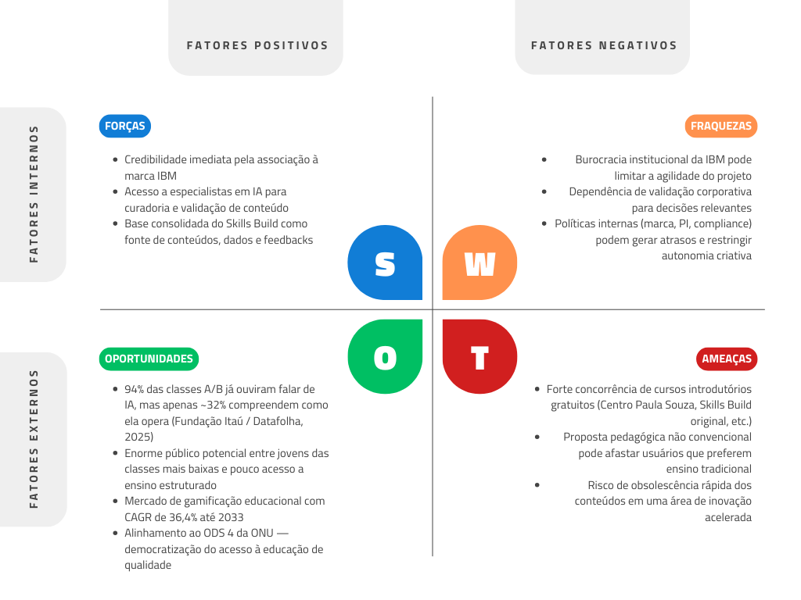
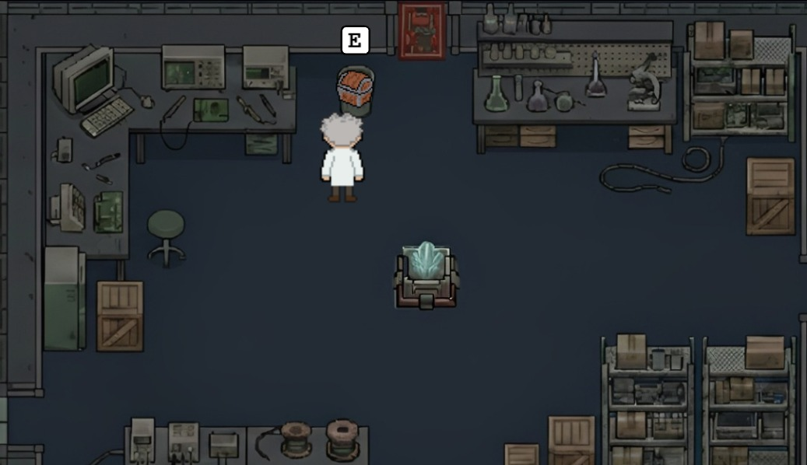

# GDD - Game Design Document - Módulo 1 - Inteli

**_Os trechos em itálico servem apenas como guia para o preenchimento da seção. Por esse motivo, não devem fazer parte da documentação final_**

## Nome do Grupo

#### Nomes dos integrantes do grupo

- <a href="https://www.linkedin.com/in/ana-carvalho-27268634b">Ana Luiza Lima de Carvalho</a>
- <a href="https://www.linkedin.com/in/dante-cavalcante-rocha-4555993b0?utm_source=share_via&utm_content=profile&utm_medium=member_ios">Dante Cavalcante Rocha</a>
- <a href="https://www.linkedin.com/in/eduardo-quessada-batistussi-68889028a/">Eduardo Quessada Batistussi</a> 
- <a href="https://www.linkedin.com/in/gustavo-gomes-437b94312/">Gustavo da Silva Gomes</a> 
- <a href="https://www.linkedin.com/in/joseisaias">José Isaías Menezes Santos</a>
- <a href="https://www.linkedin.com/in/leticia-antunes-0a3a843aa/">Leticia Antunes de Freitas</a> 
- <a href="https://www.linkedin.com/in/lucas-andrade-silva-1b7b82375">Lucas Andrade Silva</a> 
- <a href="https://www.linkedin.com/in/tiago-t-335a833aa/">Tiago Pires Tavolieri</a>

## Sumário

[1. Introdução](#c1)

[2. Visão Geral do Jogo](#c2)

[3. Game Design](#c3)

[4. Desenvolvimento do jogo](#c4)

[5. Casos de Teste](#c5)

[6. Conclusões e trabalhos futuros](#c6)

[7. Referências](#c7)

[Anexos](#c8)

<br>


# <a name="c1"></a>1. Introdução (sprints 1 a 4)

## 1.1. Plano Estratégico do Projeto

### 1.1.1. Contexto da indústria (sprint 2)

Impulsionada pela pandemia, a indústria de jogos educativos tornou-se um dos nichos mais produzidos no Brasil ¹. Enquanto players consolidados mantêm o foco no ensino passivo via texto e vídeo, a tendência do mercado exige metodologias dinâmicas para ensinar essas tecnologias amplamente usadas pelas grandes empresas de IA. Aproveitando essa lacuna de engajamento prático, o IBM SkillsBuild, plataforma de cursos online, posiciona-se estrategicamente como uma plataforma gratuita de capacitação. A iniciativa de encontrar jogos educativos democratiza o aprendizado tecnológico de ponta, preparando estudantes e profissionais para as reais demandas interativas do mercado de trabalho.


#### 1.1.1.1. Modelo de 5 Forças de Porter (sprint 2)

**1. Ameaça de Novos Entrantes (Ameaça Média)**

A criação de jogos educativos focados em Inteligência Artificial exige a superação de altas barreiras de entrada, principalmente no que tange ao conhecimento técnico. Para ingressar nesse mercado, uma nova empresa precisa dominar simultaneamente duas áreas complexas: o desenvolvimento de jogos (Game Design) e a própria engenharia de IA. A falta dessa expertise técnica rigorosa pode levar à criação de produtos com falhas conceituais, ensinando estruturas de IA de forma incorreta.

Apesar dessas barreiras técnicas protegerem o mercado, a alta atratividade e o "boom" da IA podem incentivar startups e novas empresas a investirem pesado em aprendizagem gamificada. A entrada de novos players tornaria o mercado mais competitivo, forçando constante inovação na atratividade dos jogos.

**2. Ameaça de Produtos Substitutos (Ameaça Alta)**

Existem plataformas de educação já consolidadas que distribuem ensino de tecnologia de diversas formas altamente acessíveis. Plataformas de vídeo gratuitas, como o YouTube (ex: canal Curso em Vídeo), ensinam de forma didática e estimulam a prática por meio de desafios. Paralelamente, plataformas de ensino remoto por assinatura, como Alura e AWS Skill Builder, além de bootcamps ágeis como a DIO, oferecem rotas de aprendizagem validadas pelo mercado.

Esses substitutos são altamente relevantes, possuem um vasto leque de didáticas diferentes e forte reconhecimento. Como o objetivo final do usuário é "aprender IA", metodologias não gamificadas tradicionais representam um alto risco de substituição pela sua praticidade e abundância.

**3. Poder de Barganha dos Fornecedores (Poder Alto)** 

Em projetos de tecnologia e desenvolvimento de software, a principal "matéria-prima" é o capital intelectual. O desenvolvimento de um jogo educativo de IA exige especialistas de nicho: engenheiros de IA, desenvolvedores de jogos experientes e Game Designers/roteiristas capazes de criar engajamento contínuo. O poder de barganha desses profissionais é altíssimo, pois são escassos e disputados por diversas indústrias globais. A gamificação deixou de ser apenas uma dinâmica isolada e tornou-se uma decisão estratégica de produto. Consequentemente, o valor de mercado desses especialistas é muito elevado — como evidenciado na matéria do site Exame ‘’A carreira de IA que ninguém te contou e pode pagar até R$ 1,5 milhão por ano”, no qual cargos como Engenheiro de Prompt podem atingir salários excepcionais devido à alta demanda ⁷.

**4. Poder de Barganha dos Clientes (Poder Médio)**

O público-alvo abrange desde estudantes do ensino médio e universitários até profissionais em transição de carreira que buscam uma introdução facilitada ao mundo da IA. Atualmente, a maioria dos cursos tradicionais exige a leitura prolongada de documentações complexas ou a visualização de vídeos com alta carga matemática, o que afasta o iniciante. Nesse cenário, um jogo educativo reduz a fricção do aprendizado prático, oferecendo uma proposta de valor quase única e diminuindo o poder do cliente por falta de equivalentes diretos. No entanto, o custo de troca (switching cost) no mercado de educação digital é baixíssimo; se o jogo não for engajador ou falhar em explicar a IA de maneira adequada e aplicável, o cliente pode facilmente migrar para os substitutos mencionados anteriormente, mantendo o poder de barganha em um nível médio.

**5. Rivalidade entre Concorrentes (Rivalidade Alta)** 

O mercado de ensino gamificado de IA tem olhado cada vez mais para um público maior e sem o conhecimento, porque não sabe manusear as plataformas. Isso limita avanços para conseguir vender suas próprias IAs e como todo negócio esse é um ramo muito lucrativo que tem rivalidade forte para conseguir a maior fatia. Entre os concorrentes destacam-se o AWS DeepRacer ², que utiliza um simulador 3D gamificado focado estritamente em Aprendizado por Reforço, e o Google Cloud Skills Boost ³, que utiliza laboratórios práticos e um sistema de badges (conquistas) para o ensino de IA na nuvem. Embora essas grandes empresas dominem nichos segmentados, suas ferramentas costumam ter limitações de uso atreladas a custos de infraestrutura (versões pagas após testes) ou focam exclusivamente em seus próprios ecossistemas corporativos.


### 1.1.2. Análise SWOT (sprint 2)



**Forças**

As principais forças do projeto decorrem da parceria com a IBM, conferindo, por exemplo, credibilidade imediata ao jogo e contato com especialistas em IA, garantindo rigor técnico e relevância no aprendizado. Além da base já consolidada do Skills Build, que traz um eixo de conteúdos e dados para se apoiar. Soma-se a isso a própria composição da equipe, formada por integrantes que fazem parte do público-alvo e com diferentes níveis de conhecimento em IA, possibilitando testar internamente a clareza e a eficácia da abordagem pedagógica do jogo, validando o processo de ensino a partir da própria experiência de aprendizagem do grupo.

**Fraquezas**

As fraquezas são, em boa medida, o reverso das forças. A vinculação a uma big tech consolidada traz consigo processos burocráticos que podem ser restritivos para um projeto em fase inicial. Toda decisão relevante depende de validação institucional da IBM, o que pode comprometer a agilidade necessária nas primeiras etapas de desenvolvimento. Há também uma dependência de dados e de políticas internas da empresa — como regras de uso de marca, propriedade intelectual e compliance — que podem gerar atrasos e limitar a autonomia criativa da equipe.

**Oportunidades**

O crescimento acelerado do mercado de IA, aliado à lacuna de conhecimento no Brasil, representa uma grande oportunidade. Embora a maioria da população já tenha ouvido falar em IA e 75% afirmem utilizá-la no cotidiano, poucos sabem defini-la corretamente, revelando um amplo público potencial — especialmente entre jovens das classes C, D e E. Paralelamente, o mercado de gamificação educacional está em forte expansão, com projeções bilionárias e alto crescimento anual. Nesse cenário, um jogo educativo sobre IA nos posiciona como early adopters e contribui para democratizar o acesso ao conhecimento, alinhando-se ao ODS 4 da ONU ⁴.

**Ameaças**

A principal ameaça é a concorrência. Uma busca simples por "curso introdutório de IA" no Google retorna diversas opções gratuitas — como o curso do Centro Paula Souza —, e o próprio Skills Build original pode ser percebido como alternativa mais direta e tradicional. O fato de o jogo adotar uma abordagem pedagógica diferenciada é ao mesmo tempo um diferencial e um risco, já que parte do público pode preferir métodos de ensino convencionais, especialmente num primeiro contato com o tema. Outra ameaça relevante é a velocidade de obsolescência dos conteúdos. Em uma área em que avanços disruptivos ocorrem em questão de meses, manter o jogo atualizado exigirá um processo contínuo de revisão, o que representa um custo operacional significativo ⁴.


### 1.1.3. Missão / Visão / Valores (sprint 2)

**Missão:**

Democratizar o acesso a conhecimentos sobre de IA para jovens de todas as classes sociais através da gamificação com um jogo web de fácil acesso.

**Visão:**

Ser um modelo nacional na implementação da gamificação para educação de IA de maneira inclusiva. 

**Valores:**

Educação lúdica, democratização da IA, ensino nativo digital, aprendizado por descoberta, lisura e ética em IA.

### 1.1.4. Proposta de Valor (sprint 4)

*Posicione aqui o canvas de proposta de valor. Descreva os aspectos essenciais para a criação de valor da ideia do produto com o objetivo de ajudar a entender melhor a realidade do cliente e entregar uma solução que está alinhado com o que ele espera.*

### 1.1.5. Descrição da Solução Desenvolvida (sprint 4)

*Descreva brevemente a solução desenvolvida para o parceiro de negócios. Descreva os aspectos essenciais para a criação de valor da ideia do produto com o objetivo de ajudar a entender melhor a realidade do cliente e entregar uma solução que está alinhado com o que ele espera. Observe a seção 2 e verifique que ali é possível trazer mais detalhes, portanto seja objetivo aqui. Atualize esta descrição até a entrega final, conforme desenvolvimento.*

### 1.1.6. Matriz de Riscos (sprint 4)

*Registre na matriz os riscos identificados no projeto, visando avaliar situações que possam representar ameaças e oportunidades, bem como os impactos relevantes sobre o projeto. Apresente os riscos, ressaltando, para cada um, impactos e probabilidades com plano de ação e respostas.*

### 1.1.7. Objetivos, Metas e Indicadores (sprint 4)

*Definição de metas SMART (específicas, mensuráveis, alcançáveis, relevantes e temporais) para seu projeto, com indicadores claros para mensuração*

## 1.2. Requisitos do Projeto (sprints 1 e 2)

\# | Requisito  
--- | ---
1 | O jogo é iniciado com um toque em qualquer local da tela inicial.
2 | O controle do personagem será realizado usando as teclas direcionais (→ ↑ ↓ ←) para navegação e a  interação com itens presentes no jogo será realizada com a tecla E.
3 | A tela do mapa ficará com brilho baixo a não ser perto do personagem, onde haverá uma luz que o acompanha para que o jogador tenha a sensação de estar explorando o ambiente. 
4 | O robô acompanhará o jogador durante a movimentação após a primeira fase do jogo.
5 | Haverá uma barra de progresso na tela para que o jogador saiba o nível do conhecimento adquirido.
6 | No decorrer do jogo o jogador desbloqueará conquistas a cada fase, que simbolizarão o conhecimento adquirido e apenas com todas elas ele poderá desbloquear a fase final.

## 1.3. Público-alvo do Projeto (sprint 2)

O público-alvo do jogo são jovens universitários com pouco ou nenhum contato aprofundado com tecnologia — especialmente com Inteligência Artificial. A maioria dessas pessoas limita sua experiência de AI ao uso casual de chatbots como ChatGPT, Gemini ou Claude, o que reflete bem a realidade, em que pesquisas, por exemplo, indicam que menos de 30% das empresas nos EUA de fato adotaram IA em seus processos, evidenciando que a expertise do grande público nessa área é frequentemente superestimada. Por ser um jogo introdutório, ele se encaixa tanto para estudantes de cursos que demandam apenas um uso superficial de IA quanto para calouros de cursos como Ciência da Computação, Engenharia de Software ou Engenharia da Computação que ainda não tiveram uma base sólida no tema, funcionando de forma análoga ao pré-cálculo adotado por diversas universidades para nivelar estudantes com lacunas matemáticas, mas para o uso de AI e sendo muito mais divertido e engajante ⁵.

O perfil mais representativo do nosso usuário é o de um jovem de renda média-baixa, criado fora dos grandes centros urbanos e egresso de escola pública, levando em conta que mais de 80% dos estudantes do ensino médio brasileiro vem de escolas públicas, o público potencial do jogo seria bem grande. Esse usuário potencial do jogo tem afinidade e desenvoltura com tecnologias acessíveis do cotidiano, como celulares e videogames, mas nunca teve a oportunidade de se aprofundar tecnicamente. Agora, ao ingressar na universidade, enfrenta pela primeira vez a necessidade de desenvolver uma compreensão mais sólida da área, e é exatamente para esse primeiro passo que o jogo foi pensado ⁶.

# <a name="c2"></a>2. Visão Geral do Jogo (sprint 2)

## 2.1. Objetivos do Jogo (sprint 2)

O objetivo do jogo é ensinar o básico de inteligência artificial de um jeito divertido e que prenda a atenção do usuário (através de minigames e puzzles) , sempre tentando fazê-lo se conectar com a história e os personagens de um modo que seu aprendizado seja mais eficiente. E com isso, queremos despertar o interesse dos universitários sobre o assunto IA para que eles busquem os cursos de tecnologia da IBM.


## 2.2. Características do Jogo (sprint 2) 

O jogo é uma historia repleta de acão onde a protagonista deverá passar por desafios e durantes eles irá aprender sobre os fundamentos basicos da IA. O jogo tem graficos simples feitos no Piskel. Os personagens são a peca chave para o jogo, todos tem um contexto, historia e motivacões, assim deixando o jogador mais conectado com o jogo. 

### 2.2.1. Gênero do Jogo (sprint 2)

*O gênero do nosso jogo é de aventura, tendo modo história, ação e puzzles, tudo isso com o objetivo de ensinar.

### 2.2.2. Plataforma do Jogo (sprint 2)

O jogo será desenvolvido para plataforma Web, sendo executado diretamente no navegador por meio do framework Phaser.

Será compatível com:
Computadores (desktop e notebook) — Windows, macOS e Linux

O jogo poderá ser acessado em qualquer dispositivo com navegador moderno atualizado (como Chrome, Safari, Edge ou Firefox) que suporte HTML5 e JavaScript, desde que possua desempenho suficiente para executar aplicações desenvolvidas em Phaser.

Para interface e os controles serão necessários teclado e mouse independente do dispositivo.

O objetivo dessas medidas é garantir ampla acessibilidade, sem necessidade de instalação, permitindo que o jogador acesse o jogo diretamente por um link, em poucos passos e sem depender de um dispositivo mais potente e, consequentemente, caro.


### 2.2.3. Número de jogadores (sprint 2)

Apenas um jogador. Nosso jogo é uma história onde apenas 1 jogador é controlável, a nossa protagonista Sophia.


### 2.2.4. Títulos semelhantes e inspirações (sprint 2)

Nós nos inspiramos em jogos baseados em minigames (o jeito que nós iremos ensinar o usuário) , Hollow Knight (Design, como a luz em torno do personagem), Spaceship Runner e Among Us ( Gráfico e puzzles) , a inteligência artificial Learn Ia (Desenvolvimento de habilidades de IA, baseado em textos).


### 2.2.5. Tempo estimado de jogo (sprint 5)

*Ex. O jogo pode ser concluído em 3 horas passando por todas as fases.*

*Ex. cada partida dura até 15 minutos*

# <a name="c3"></a>3. Game Design (sprints 2 e 3)

## 3.1. Enredo do Jogo (sprints 2 e 3)

Em um mundo onde a Inteligência Artificial ainda está em fase de desenvolvimento, surge a constante indagação sobre como essa tecnologia afetará o futuro da sociedade. A narrativa tem início em 2022, em um laboratório de pesquisa focado em aprendizado de máquina e robótica, repleto de profissionais renomados. Entre eles destaca-se Sophia, uma cientista brilhante reconhecida por sua curiosidade inata, mente analítica e criatividade na resolução de problemas. Ao iniciar o jogo, nós a encontramos no laboratório, rodeada por colegas que conduzem seus experimentos.

Logo, Sophia é convocada para uma conversa com Watson, o cientista-chefe visionário responsável por ideias únicas. O diálogo gira em torno do perigo iminente que as criações dos agentes robóticos autônomos projetados para automatizar tarefas humanas, do laboratório, podem representar no futuro. Com a idade avançada, Watson tem um mau pressentimento: ele teme que a liderança do projeto caia em mãos erradas e que a tecnologia seja utilizada para ganho de poder e dominação.

Para evitar esse cenário trágico, o líder convence Sophia a passar por um processo de criogenia. Seu corpo seria totalmente congelado para despertar apenas em 2099, tornando-se a esperança de um final promissor para o destino das máquinas inteligentes. Embora receosa, a cientista aceita, pois dedicou toda a sua vida à ciência. A relação dos dois, no entanto, vai além do ambiente profissional: Watson a adotou no passado, tornando-a sua filha e companheira de pesquisas até ela se consolidar como uma grande referência na área. Contudo, esse laço gera atrito com os demais colegas, que não a consideram digna de herdar o legado da empresa por não compartilhar do mesmo sangue do criador. Com profunda tristeza no olhar, Sophia se despede do pai adotivo, prometendo fazer o impossível para que suas criações sejam usadas para o bem da sociedade.

Muitas décadas depois, a câmara criogênica se abre e a protagonista desperta em um mundo futuro e desconhecido. O antigo laboratório encontra-se em ruínas. Os piores temores de Watson se confirmaram: a realidade foi devastada pelo uso de IAs treinadas com o intuito de destruir o bem comum. Antes do congelamento, seu pai a havia alertado sobre Asimov, um robô criado por ele e mantido em absoluto segredo. Dotado de uma personalidade lógica, comportamento protetor e inteligência extrema, Asimov é capaz de solucionar qualquer dilema. Encontrá-lo torna-se, então, a missão principal de Sophia.

Ao explorar os escombros, ela chega a um depósito de sucata eletrônica da antiga instalação. Lá, localiza Asimov, um robô de um olho só, que apresenta diversas falhas sistêmicas e perda de memória. Sem acesso físico direto a ele, a protagonista precisa guiá-lo verbalmente para fora dos destroços. O jogador passa, então, por três caminhos horizontais repletos de obstáculos. Superada essa fase, Asimov consolida-se como um companheiro de jornada.

A partir desse momento, o objetivo central passa a ser o reaprendizado sobre IAs. Embora o robô detenha o conhecimento necessário, seus danos técnicos fazem com que as informações sejam repassadas de forma fragmentada. Para restaurar o banco de dados completo de Asimov, Sophia precisa de um item fundamental: um cristal de silício que deve ser inserido na estrutura interna da máquina.

Sabendo disso, a cientista sai das ruínas do laboratório em busca dos parâmetros corretos para forjar esse cristal. Os dados estão armazenados em uma das muitas antigas sedes corporativas da região. Como procurar de porta em porta seria inviável, Sophia utiliza suas habilidades para treinar uma rede neural artificial e classificar as características visuais de uma porta específica o qual a leva para o lugar correto.

No interior da instalação, ela encontra diversos arquivos detalhando minerais raros. Mais uma vez, é necessário treinar o sistema, agora para classificar e separar os dados entre "cristal adequado" e "cristal inadequado". Assim que localiza as especificações corretas, a Sophia corre contra o tempo, já que Asimov está prestes a desligar permanentemente.

Sophia se dirige ao hub de fabricação e insere todas as características processadas na cúpula central para iniciar a sintetização. Com o mineral forjado, ela finalmente o acopla ao robô, garantindo sua recuperação total e reativando a esperança para o futuro.

## 3.2. Personagens (sprints 2 e 3)

### 3.2.1. Controláveis

Sophia é a protagonista controlável do jogo, uma estagiária, engenheira e cientista brilhante marcada por sua curiosidade natural, inteligência analítica, criatividade para resolver problemas e determinação em aprender mesmo diante das dificuldades. Suas habilidades incluem analisar tecnologias abandonadas, programar sistemas, construir e reparar equipamentos e solucionar desafios científicos, evoluindo conforme o passar da história do jogo. Movida pelo desejo de ajudar a humanidade, ela ‘’atravessa’’ o tempo e chega a um futuro em que as pessoas se tornaram completamente dependentes da inteligência artificial, abandonando livros e o pensamento crítico ao armazenar todo o conhecimento humano em grandes bancos de dados controlados por IA. Ao lado do robô Asimov, Sophia inicia uma jornada em busca de uma inteligência artificial capaz de restaurar o equilíbrio da sociedade, começando como alguém que depende da ajuda de Asimov, mas amadurecendo à medida que ele passa a apresentar falhas constantes, desse modo fazendo ela agir de forma independente. Durante a aventura, ela aprende a criar uma nova IA em um laboratório improvisado, explora o laboratório em busca de recursos essenciais e aplica todo o conhecimento adquirido para enfrentar o vírus que corrompe os sistemas e ameaça destruir Asimov.

<div align = "center">

<sup>Figura 1: Imagem da Sophia.</sup><br>

<br>

<sub>Fonte: Material produzido pelos autores (2026). </sub><br>

</div>

### 3.2.2. Non-Playable Characters (NPC)

O nosso jogo possui outros 2 personagens. O primeiro é o Asimov, o companheiro robótico que acompanha Sophia durante a maior parte da jornada, caracterizado por sua personalidade lógica, comportamento protetor e inteligência extrema, além de habilidades como acesso a bancos de dados, tradução de informações antigas e suporte tecnológico em campo, funcionando inicialmente como guia e apoio constante ao jogador. Criado para auxiliar cientistas em um possível futuro corrompido, ele ajuda Sophia a compreender o mundo dominado pela inteligência artificial e facilita tarefas complexas, mas começa a apresentar falhas que aumentam ao decorrer do jogo, causadas pelo vírus que corrompe os sistemas globais. Ao longo da história, Asimov deixa de ser apenas uma ferramenta e passa a desenvolver uma relação de amizade com Sophia, tornando seu destino emocionalmente significativo e relevante.

<div align = "center">

<sup>Figura 1: Imagem da Sophia.</sup><br>

<br>

<sub>Fonte: Material produzido pelos autores (2026). </sub><br>

</div>

O segundo e menos desenvolvido na história do jogo é o cientista-chefe Watson, responsável por idealizar o plano de salvação da humanidade, sendo um pesquisador visionário e estratégico que previu o risco da dependência excessiva da inteligência artificial. Foi ele quem concebeu a criação do robô Asimov e decidiu pelo congelamento criogênico de Sophia, acreditando que, caso uma calamidade tecnológica acontecesse no futuro, alguém com pensamento crítico humano poderia despertar e restaurar o equilíbrio do mundo.

<div align = "center">

<sup>Figura 1: Imagem da Sophia.</sup><br>

<br>

<sub>Fonte: Material produzido pelos autores (2026). </sub><br>

</div>

### 3.2.3. Diversidade e Representatividade dos Personagens

Considerando que o público-alvo são estudantes universitários interessados em aprender inteligência artificial, mas que enfrentam dificuldades com conteúdos muito teóricos, os personagens do jogo se conectam diretamente com essa realidade e ajudam a despertar interesse pelos cursos de tecnologia oferecidos pela IBM. Sophia representa o estudante que aprende na prática, experimentando, errando e evoluindo aos poucos, mostrando que qualquer pessoa pode começar a entender a tecnologia mesmo sem dominar toda a teoria inicialmente. Asimov simboliza as ferramentas tecnológicas modernas e o apoio que plataformas educacionais, como os cursos da IBM, oferecem para facilitar o aprendizado. Já Watson reforça o papel da ciência, da inovação e da necessidade de preparar profissionais para o futuro. Assim, o jogo funciona como uma porta de entrada motivadora, despertando curiosidade sobre inteligência artificial e incentivando os jogadores a buscar aprofundamento por meio dos cursos tecnológicos disponibilizados pela IBM.

## 3.3. Mundo do jogo (sprints 2 e 3)

### 3.3.1. Locações Principais e/ou Mapas (sprints 2 e 3)

O jogo acontece em um mundo de ficção científica com uma atmosfera misteriosa e envolvente, onde o próprio ambiente ajuda no contexto da história. No começo, o jogo está em um laboratório moderno e bem cuidado, cheio de tecnologia avançada, luzes claras e equipamentos funcionando, transmitindo uma sensação de segurança e descoberta científica. Mais tarde, o jogador retorna ao mesmo laboratório, mas no futuro, encontrando o lugar abandonado, escuro e deteriorado, com máquinas quebradas e um clima mais pesado e silencioso, criando uma sensação de estranheza e suspense ao mostrar como tudo mudou com o tempo. Em outra fase, o jogo se passa em um lixão, um cenário caótico formado por sucatas e restos tecnológicos descartados, com um ambiente poluído e desorganizado que reforça a ideia de abandono.

### 3.3.2. Navegação pelo mundo (sprints 2 e 3)

_**Movimentação dos Personagens**_

**Controles de Movimento**

| Tecla | Ação |
| :--- | :--- |
| **W** | Move o personagem para frente |
| **A** | Move o personagem para a esquerda |
| **S** | Move o personagem para trás |
| **D** | Move o personagem para a direita |

---

**Interações**
A tecla **E** é utilizada para interagir com:
* **Itens do cenário**
* **NPCs**
* **Objetos interativos**

---

**Tipo de Movimentação**
* **Perspectiva:** Terceira pessoa
* **Exploração:** Livre dentro do mapa da fase atual

---

_**Estrutura e Funcionamento**_

| Elemento | Funcionamento |
| :--- | :--- |
| **Estrutura das fases** | Linear |
| **Ordem das fases** | Sequencial e pré-definida |
| **Condição para avançar** | Concluir todas as tasks da fase |
| **Resultado do avanço** | Desbloqueio de nova área |
| **Progressão narrativa** | Acontece a cada fase concluída |

### 3.3.3. Condições climáticas e temporais (sprints 2 e 3)

NÃO APLICÁVEL.

### 3.3.4. Concept Art (sprint 2)

Link para o acesso do Concept Art no docs: https://docs.google.com/document/d/19yr0fiV42CK17oZ3km1qEDT_DGSezbkxb-5vpMVW58o/edit?usp=sharing

### 3.3.5. Trilha sonora (sprint 4)

*Descreva a trilha sonora do jogo, indicando quais músicas serão utilizadas no mundo e nas fases. Utilize listas ou tabelas para organizar esta seção. Caso utilize material de terceiros em licença Creative Commons, não deixe de citar os autores/fontes.*

*Exemplo de tabela*
\# | titulo | ocorrência | autoria
--- | --- | --- | ---
1 | tema de abertura | tela de início | própria
2 | tema de combate | cena de combate com inimigos comuns | Hans Zimmer
3 | ... 

## 3.4. Inventário e Bestiário (sprint 3)

### 3.4.1. Inventário

*\<opcional\> Caso seu jogo utilize itens ou poderes para os personagens obterem, descreva-os aqui, indicando títulos, imagens, meios de obtenção e funções no jogo. Utilize listas ou tabelas para organizar esta seção. Caso utilize material de terceiros em licença Creative Commons, não deixe de citar os autores/fontes.* 

*Exemplo de tabela*
\# | item |  | como obter | função | efeito sonoro
--- | --- | --- | --- | --- | ---
1 | moeda |  | há muitas espalhadas em todas as fases | acumula dinheiro para comprar outros itens | som de moeda
2 | madeira |  | há muitas espalhadas em todas as fases | acumula madeira para construir casas | som de madeiras
3 | ... 

### 3.4.2. Bestiário

*\<opcional\> Caso seu jogo tenha inimigos, descreva-os aqui, indicando nomes, imagens, momentos de aparição, funções e impactos no jogo. Utilize listas ou tabelas para organizar esta seção. Caso utilize material de terceiros em licença Creative Commons, não deixe de citar os autores/fontes.* 

*Exemplo de tabela*
\# | inimigo |  | ocorrências | função | impacto | efeito sonoro
--- | --- | --- | --- | --- | --- | ---
1 | robô terrestre |  |  a partir da fase 1 | ataca o personagem vindo pelo chão em sua direção, com velocidade constante, atirando parafusos | se encostar no inimigo ou no parafuso arremessado, o personagem perde 1 ponto de vida | sons de tiros e engrenagens girando
2 | robô voador |  | a partir da fase 2 | ataca o personagem vindo pelo ar, fazendo movimento em 'V' quando se aproxima | se encostar, o personagem perde 3 pontos de vida | som de hélice
3 | ... 

## 3.5. Gameflow (Diagrama de cenas) (sprint 2)

*Posicione aqui seu "storyboard de programação" - o diagrama de cenas do jogo. Indique, por exemplo, como o jogo começa, quais opções o jogador tem, como ele avança nas fases, quais as condições de 'game over', como o jogo reinicia. Seu diagrama deve representar as classes, atributos e métodos usados no jogo.*

<div align="center">
  <sub>Storyboard de programação</sub><br>
  <br>
  <sup>Fonte: Material produzido pelos autores (2026).</sup>
</div>

## 3.6. Regras do jogo (sprint 3)

*Descreva aqui as regras do seu jogo: objetivos/desafios, meios para se conseguir alcançar*

*Ex. O jogador deve pilotar o carro e conseguir terminar a corrida dentro de um minuto sem bater em nenhum obstáculo.*

*Ex. O jogador deve concluir a fase dentro do tempo, para obter uma estrela. Se além disso ele coletar todas as moedas, ganha mais uma estrela. E se além disso ele coletar os três medalhões espalhados, ganha mais uma estrela, totalizando três. Ao final do jogo, obtendo três estrelas em todas as fases, desbloqueia o mundo secreto.*  

## 3.7. Mecânicas do jogo (sprint 3)

*Descreva aqui as formas de controle e interação que o jogador tem sobre o jogo: quais os comandos disponíveis, quais combinações de comandos, e quais as ações consequentes desses comandos. Utilize listas ou tabelas para organizar esta seção.*

*Ex. Em um jogo de plataforma 2D para desktop, o jogador pode usar as teclas WASD para mecânicas de andar, mirar para cima, agachar, e as teclas JKL para atacar, correr, arremesar etc.*

*Ex. Em um jogo de puzzle para celular, o jogador pode tocar e arrastar sobre uma peça para movê-la sobre o tabuleiro, ou fazer um toque simples para rotacioná-la*

## 3.8. Implementação Matemática de Animação/Movimento (sprint 4)

*Descreva aqui a função que implementa a movimentação/animação de personagens ou elementos gráficos no seu jogo. Sua função deve se basear em alguma formulação matemática (e.g. fórmula de aceleração). A explicação do funcionamento desta função deve conter notação matemática formal de fórmulas/equações. Se necessário, crie subseções para sua descrição.*

# <a name="c4"></a>4. Desenvolvimento do Jogo

## 4.1. Desenvolvimento preliminar do jogo (sprint 1)

Na primeira sprint o grupo desenvolveu a versão inicial do jogo, tendo como foco os requisitos 1 e 2 do Game Design Document (GDD). A primeira versão é composta pela tela inicial, que contém o botão "Play" para que o jogador inicie o jogo.

No decorrer do desenvolvimento, foi construída a tela de uma das fases do jogo, em que o jogador poderá explorar a sala que o personagem está e interagir com um dos items.

<div align = "center">

<sup>Figura 1: Imagem do personagem da primeira fase.</sup><br>

<br>

<sub>Fonte: Material produzido pelos autores (2026). </sub><br>

<sup>Figura 2: Imagem do personagem interagindo com um item.</sup><br>

<br>

<sub>Fonte: Material produzido pelos autores (2026). </sub><br>

</div>

Nesta tela também foram implementados um sistema de colisão básico — em apenas alguns pontos da tela — e um balão de chat.


<div align = "center">

<sup>Figura 3: Imagem da matriz de colisão na primeira tela.</sup><br>

<br>

<sub>Fonte: Material produzido pelos autores (2026). </sub><br>

<sup>Figura 4: Imagem do balão de chat na tela.</sup><br>

<br>

<sub>Fonte: Material produzido pelos autores (2026). </sub><br>

</div>

Para os próximos passos, o grupo deseja implementar os requisitos 3 e 4, adicionar novas fases para implemnetar os requisitos 5 e 6.

## 4.2. Desenvolvimento básico do jogo (sprint 2)

# Seção 4.2 - Redação do desenvolvimento básico

- Em relação ao código foram feitas as cenas 1 e 2.

---

## SCENE 1

- **Contexto:** personagem principal está no laboratório junto com uma equipe de cientistas, onde o líder dessa equipe terá uma conversa com a personagem principal sobre o problema causado pelo uso inadequado de AI (contexto).

- **Parte técnica:**
  1. Cena se passa em um laboratório de alta tecnologia;
  2. Personagens: Dr. Watson (líder), Sophia (jogador) e NPC´s de fundo (cientistas);
  3. Gameplay: WASD ou SETAS.

**Código utilizado para criar colisão sobre todos os objetos do mapa na scene:**

``` javascript 
// adiciona colisão a todos os objetos do laboratório pela função criarColisao 
this.criarColisao(this.armario);
this.criarColisao(this.armario2);
this.criarColisao(this.mesa1);
this.criarColisao(this.mesa2);
this.criarColisao(this.mesa3);
this.criarColisao(this.pilar);
this.criarColisao(this.reservAsCri);
this.criarColisao(this.alvo);
this.criarColisao(this.alvo2);
this.criarColisao(this.criogenia);

// colisão apenas na parte de baixo dos computadores
this.criarColisao(this.computador1p1);
this.criarColisao(this.computador2p2);
this.criarColisao(this.computador3p2);
this.criarColisao(this.computador4p2);   
``` 

**Código utilizado para adicionar o personagem principal na scene 1:**

```javascript
// adiciona o personagem principal
this.Principal = this.physics.add
    .sprite(400, 300, "sophia")
    .setScale(2)
    .setCollideWorldBounds(true);

this.Principal.setDepth(2);
this.Principal.body.setAllowGravity(false);
this.Principal.setSize(36, 25);
this.Principal.setOffset(15, 30);

this.physics.add.collider(this.Principal, this.camera);
this.physics.add.collider(this.Principal, this.paredes);
this.physics.add.collider(this.Principal, this.objetosColisao);
```

---

**Código utilizado para adicionar a função de apertar a letra “E” e aparecer uma mensagem de texto quando você estiver em determinado lugar do mapa:**

```javascript
// HUD (Interface do usuário)

// cria um container da tecla "E"
this.containerTecla = this.add.container(0, 0);

let iconeTecla = this.add.graphics();
iconeTecla.fillStyle(0xffffff, 1);
iconeTecla.lineStyle(2, 0x000000, 1);
iconeTecla.fillRoundedRect(-70, -20, 140, 40, 10);
iconeTecla.strokeRoundedRect(-70, -20, 140, 40, 10);

let letra = this.add.text(0, 0, "Aperte E", {
    fontSize: "25px",
    color: "#000000",
    fontStyle: "bold"
}).setOrigin(0.5);

this.containerTecla.add([iconeTecla, letra]);
this.containerTecla.setVisible(false);

// animação de "flutuar"
this.tweens.add({
    targets: this.containerTecla,
    y: "+=5",
    duration: 800,
    yoyo: true,
    repeat: -1,
});
```

---

**Código utilizado para criar um efeito sobre a mensagem que aparece quando a letra “E” é clicada, quando for solicitado que ela seja acionada para uma caixa de texto aparecer:**

```javascript
mostrarMensagem(textoCompleto) {
    this.lendoMensagem = true;
    this.caixaDialogo.setVisible(true);
    this.textoDialogo.setVisible(true);
    this.textoDialogo.setText("");

    let letraAtual = 0;

    if (this.timerEscrever) this.timerEscrever.remove();

    this.timerEscrever = this.time.addEvent({
        delay: 30,
        callback: () => {
            this.textoDialogo.text += textoCompleto[letraAtual];
            letraAtual++;
        },
        repeat: textoCompleto.length - 1,
    });
}

fecharMensagem() {
    if (this.timerEscrever && this.timerEscrever.getProgress() < 1) {
        this.timerEscrever.remove();
        return;
    }

    this.lendoMensagem = false;
    this.caixaDialogo.setVisible(false);
    this.textoDialogo.setVisible(false);
    this.textoDialogo.setText("");

    this.cameras.main.fadeOut(1000);

    this.cameras.main.once("camerafadeoutcomplete", () => {
        this.scene.start("SceneFuturo");
    });
}
```

---

**Código utilizado para criar uma caixa de diálogo no jogo:**

```javascript
// Cria caixa de diálogo (HUD)
this.caixaDialogo = this.add.graphics();

this.caixaDialogo.fillStyle(0x1a1a1a, 0.9);
this.caixaDialogo.lineStyle(4, 0xffffff, 1);
this.caixaDialogo.fillRoundedRect(xCaixa, yCaixa, larguraCaixa, alturaCaixa, 15);
this.caixaDialogo.strokeRoundedRect(xCaixa, yCaixa, larguraCaixa, alturaCaixa, 15);

this.caixaDialogo.setScrollFactor(0).setDepth(100).setVisible(false);

this.textoDialogo = this.add.text(xCaixa + 40, yCaixa + 35, "", {
    fontSize: "26px",
    fontFamily: "'Courier New', Courier, monospace",
    color: "#ffffff",
    wordWrap: { width: larguraCaixa - 80 },
    lineSpacing: 10,
})
.setScrollFactor(0)
.setDepth(101);
```

---

## SCENE 2

- **Contexto:** o objetivo do jogador nessa fase será encontrar o protótipo chamado de Asimov.

- **Parte técnica:**
  1. Essa fase se passa no mesmo laboratório da cena 1, mas no futuro, onde o laboratório está todo destruído;
  2. Personagens: Sophia (jogador) e Asimov (protótipo).

**Código utilizado para o sistema de colisão da scene 2:**

```javascript
// Sistema de colisão
try {
    this.collisionImage = this.textures.get("colisao").getSourceImage();
    this.collisionCanvas = document.createElement("canvas");
    this.collisionCanvas.width = this.collisionImage.width;
    this.collisionCanvas.height = this.collisionImage.height;

    this.collisionCtx = this.collisionCanvas.getContext("2d");
    this.collisionCtx.drawImage(this.collisionImage, 0, 0);
} catch (e) {
    console.warn("Aviso: Rodar em servidor local para colisão funcionar corretamente.");
}
```

**Código utilizado para adicionar o elemento “baú” ao mapa da scene 2:**

```javascript
// Baú
this.bauAnimado = this.add.sprite(520, 160, "bauAnimado").setScale(2.3);

if (!this.anims.exists("fechado")) {
    this.anims.create({
        key: "fechado",
        frames: [{ key: "bauAnimado", frame: 0 }],
        frameRate: 1,
    });

    this.anims.create({
        key: "abrindo",
        frames: this.anims.generateFrameNumbers("bauAnimado", {
            start: 0,
            end: 1,
        }),
        frameRate: 2,
        repeat: 0,
    });
}

this.bauAnimado.play("fechado");

this.cientistaLider = this.add
    .sprite(400, 300, "cientistaLider")
    .setScale(2);
```

---

**Código utilizado para estabelecer a lógica da interação da cena 2:**

```javascript
// Lógica de interação
let distBau = Phaser.Math.Distance.Between(
    this.cientistaLider.x,
    this.cientistaLider.y,
    this.bauAnimado.x,
    this.bauAnimado.y
);

let distCentro = Phaser.Math.Distance.Between(
    this.cientistaLider.x,
    this.cientistaLider.y,
    600,
    400
);
```

## 4.3. Desenvolvimento intermediário do jogo (sprint 3)

*Descreva e ilustre aqui o desenvolvimento da versão intermediária do jogo, explicando brevemente o que foi entregue em termos de código e jogo. Utilize prints de tela para ilustrar. Indique as eventuais dificuldades e próximos passos.*

## 4.4. Desenvolvimento final do MVP (sprint 4)

*Descreva e ilustre aqui o desenvolvimento da versão final do jogo, explicando brevemente o que foi entregue em termos de MVP. Utilize prints de tela para ilustrar. Indique as eventuais dificuldades e planos futuros.*

## 4.5. Revisão do MVP (sprint 5)

*Descreva e ilustre aqui o desenvolvimento dos refinamentos e revisões da versão final do jogo, explicando brevemente o que foi entregue em termos de MVP. Utilize prints de tela para ilustrar.*

# <a name="c5"></a>5. Testes

## 5.1. Casos de Teste (sprints 2 a 4)

| pré-condição                          | descrição do teste                              | pós-condição                                              |
|----------------------------------------|--------------------------------------------------|-----------------------------------------------------------|
| partida iniciada                      | pressionar teclas WASD ou setas                 | personagem se move corretamente nas direções corretamente |
| personagem próximo a obstáculo/colisão| movimentar personagem contra a parede/objeto   | personagem não atravessa a parede ou o objeto            |
| missão ativa                          | completar objetivo da missão                   | missão marcada como concluída e recompensa entregue      |
| partida iniciada                      | jogar por 30 min em qualidade alta             | FPS estável                                              |
| usuário acessa URL do jogo            | clica em "iniciar"                              | jogo inicia corretamente                                 |
| jogador atinge condição de derrota    | continuar jogando até perder                   | reiniciar a fase                                         |
| jogo publicado online                 | abrir o jogo em diferentes navegadores         | jogo funciona corretamente em todas                      |


## 5.2. Testes de jogabilidade (playtests) (sprint 5)

### 5.2.1 Registros de testes

*Descreva nesta seção as sessões de teste/entrevista com diferentes jogadores. Registre cada teste conforme o template a seguir.*

Nome | João Jonas (use nomes fictícios)
--- | ---
Já possuía experiência prévia com games? | sim, é um jogador casual
Conseguiu iniciar o jogo? | sim
Entendeu as regras e mecânicas do jogo? | entendeu as regras, mas sobre as mecânicas, apenas as essenciais, não explorou os comandos complexos
Conseguiu progredir no jogo? | sim, sem dificuldades  
Apresentou dificuldades? | Não, conseguiu jogar com facilidade e afirmou ser fácil
Que nota deu ao jogo? | 9.0
O que gostou no jogo? | Gostou  de como o jogo vai ficando mais difícil ao longo do tempo sem deixar de ser divertido
O que poderia melhorar no jogo? | A responsividade do personagem aos controles, disse que havia um pouco de atraso desde o momento do comando até a resposta do personagem

### 5.2.2 Melhorias

*Descreva nesta seção um plano de melhorias sobre o jogo, com base nos resultados dos testes de jogabilidade*

# <a name="c6"></a>6. Conclusões e trabalhos futuros (sprint 5)

*Escreva de que formas a solução do jogo atingiu os objetivos descritos na seção 1 deste documento. Indique pontos fortes e pontos a melhorar de maneira geral.*

*Relacione os pontos de melhorias evidenciados nos testes com plano de ações para serem implementadas no jogo. O grupo não precisa implementá-las, pode deixar registrado aqui o plano para futuros desenvolvimentos.*

*Relacione também quaisquer ideias que o grupo tenha para melhorias futuras*

# <a name="c7"></a>7. Referências (sprint 5)


¹ ABRA. A indústria de games BR e o nicho de jogos educativos. Disponível em: https://abra.com.br/artigos/a-industria-de-games-br-e-o-nicho-de-jogos-educativos. Acesso em: 27 fev. 2026.

² AMAZON WEB SERVICES. AWS DeepRacer. Disponível em: https://aws.amazon.com/pt/deepracer/. Acesso em: 27 fev. 2026.

³ GOOGLE CLOUD. Google Cloud Skills Boost. Disponível em: https://www.cloudskillsboost.google/. Acesso em: 27 fev. 2026.

⁴ CENTRO PAULA SOUZA. CPS lança curso livre online gratuito sobre inteligência artificial. Disponível em: https://www.cps.sp.gov.br/cps-lanca-curso-livre-online-gratuito-sobre-inteligencia-artificial/. Acesso em: 27 fev. 2026.

⁵ ZAKI, Adam. Less than a third of companies follow AI adoption best practices. CFO.com, 2025. Disponível em: https://www.cfo.com/news/less-than-third-of-companies-following-all-of-mckinseys-ai-best-practices-/742279/. Acesso em: 27 fev. 2026.

⁶ NORONHA, Heloísa. Rede pública x rede privada: onde estudam os brasileiros, conforme o IBGE. CNN Brasil, 2025. Disponível em: https://www.cnnbrasil.com.br/educacao/rede-publica-x-rede-privada-onde-estudam-os-brasileiros-conforme-o-ibge/. Acesso em: 27 fev. 2026.

⁷ EXAME. A carreira de IA que ninguém te contou e pode pagar até R$ 1,5 milhão por ano. Exame, 2025. Disponível em: https://exame.com/carreira/a-carreira-de-ia-que-ninguem-te-contou-e-pode-pagar-ate-rs-150-mil-por-ano/. Acesso em: 27 fev. 2026.

# <a name="c8"></a>Anexos

*Inclua aqui quaisquer complementos para seu projeto, como diagramas, imagens, tabelas etc. Organize em sub-tópicos utilizando headings menores (use ## ou ### para isso)*
