# GDD - Game Design Document - Módulo 1 - Inteli

**_Os trechos em itálico servem apenas como guia para o preenchimento da seção. Por esse motivo, não devem fazer parte da documentação final_**

## Nome do Grupo

#### Nomes dos integrantes do grupo

- <a href="https://www.linkedin.com/in/ana-carvalho-27268634b">Ana Luiza Lima de Carvalho</a>
- <a href="https://www.linkedin.com/in/dante-cavalcante-rocha-4555993b0?utm_source=share_via&utm_content=profile&utm_medium=member_ios">Dante Cavalcante Rocha</a>
- <a href="https://www.linkedin.com/in/eduardo-quessada-batistussi-68889028a/">Eduardo Quessada Batistussi</a> 
- <a href="https://www.linkedin.com/in/gustavo-gomes-437b94312/">Gustavo da Silva Gomes</a> 
- <a href="https://www.linkedin.com/in/joseisaias">José Isaías Menezes Santos</a>
- <a href="https://www.linkedin.com/in/leticia-antunes-0a3a843aa/">Leticia Antunes de Freitas</a> 
- <a href="https://www.linkedin.com/in/lucas-andrade-silva-1b7b82375">Lucas Andrade Silva</a> 
- <a href="https://www.linkedin.com/in/tiago-t-335a833aa/">Tiago Pires Tavolieri</a>

## Sumário

[1. Introdução](#c1)

[2. Visão Geral do Jogo](#c2)

[3. Game Design](#c3)

[4. Desenvolvimento do jogo](#c4)

[5. Casos de Teste](#c5)

[6. Conclusões e trabalhos futuros](#c6)

[7. Referências](#c7)

[Anexos](#c8)

 

# 1. Introdução (sprints 1 a 4)

## 1.1. Plano Estratégico do Projeto

### 1.1.1. Contexto da indústria (sprint 2)

Impulsionada pela pandemia, a indústria de jogos educativos tornou-se um dos nichos mais produzidos no Brasil ¹. Enquanto players consolidados mantêm o foco no ensino passivo via texto e vídeo, a tendência do mercado exige metodologias dinâmicas para ensinar essas tecnologias amplamente usadas pelas grandes empresas de IA. Aproveitando essa lacuna de engajamento prático, o IBM SkillsBuild, plataforma de cursos online, posiciona-se estrategicamente como uma plataforma gratuita de capacitação. A iniciativa de encontrar jogos educativos democratiza o aprendizado tecnológico de ponta, preparando estudantes e profissionais para as reais demandas interativas do mercado de trabalho.

#### 1.1.1.1. Modelo de 5 Forças de Porter (sprint 2)

**1. Ameaça de Novos Entrantes (Ameaça Média)**

A criação de jogos educativos focados em Inteligência Artificial exige a superação de altas barreiras de entrada, principalmente no que tange ao conhecimento técnico. Para ingressar nesse mercado, uma nova empresa precisa dominar simultaneamente duas áreas complexas: o desenvolvimento de jogos (Game Design) e a própria engenharia de IA. A falta dessa expertise técnica rigorosa pode levar à criação de produtos com falhas conceituais, ensinando estruturas de IA de forma incorreta.

Apesar dessas barreiras técnicas protegerem o mercado, a alta atratividade e o "boom" da IA podem incentivar startups e novas empresas a investirem pesado em aprendizagem gamificada. A entrada de novos players tornaria o mercado mais competitivo, forçando constante inovação na atratividade dos jogos.

**2. Ameaça de Produtos Substitutos (Ameaça Alta)**

Existem plataformas de educação já consolidadas que distribuem ensino de tecnologia de diversas formas altamente acessíveis. Plataformas de vídeo gratuitas, como o YouTube (ex: canal Curso em Vídeo), ensinam de forma didática e estimulam a prática por meio de desafios. Paralelamente, plataformas de ensino remoto por assinatura, como Alura e AWS Skill Builder, além de bootcamps ágeis como a DIO, oferecem rotas de aprendizagem validadas pelo mercado.

Esses substitutos são altamente relevantes, possuem um vasto leque de didáticas diferentes e forte reconhecimento. Como o objetivo final do usuário é "aprender IA", metodologias não gamificadas tradicionais representam um alto risco de substituição pela sua praticidade e abundância.

**3. Poder de Barganha dos Fornecedores (Poder Alto)** 

Em projetos de tecnologia e desenvolvimento de software, a principal "matéria-prima" é o capital intelectual. O desenvolvimento de um jogo educativo de IA exige especialistas de nicho: engenheiros de IA, desenvolvedores de jogos experientes e Game Designers/roteiristas capazes de criar engajamento contínuo. O poder de barganha desses profissionais é altíssimo, pois são escassos e disputados por diversas indústrias globais. A gamificação deixou de ser apenas uma dinâmica isolada e tornou-se uma decisão estratégica de produto. Consequentemente, o valor de mercado desses especialistas é muito elevado — como evidenciado na matéria do site Exame ‘’A carreira de IA que ninguém te contou e pode pagar até R$ 1,5 milhão por ano”, no qual cargos como Engenheiro de Prompt podem atingir salários excepcionais devido à alta demanda ⁷.

**4. Poder de Barganha dos Clientes (Poder Médio)**

O público-alvo abrange desde estudantes do ensino médio e universitários até profissionais em transição de carreira que buscam uma introdução facilitada ao mundo da IA. Atualmente, a maioria dos cursos tradicionais exige a leitura prolongada de documentações complexas ou a visualização de vídeos com alta carga matemática, o que afasta o iniciante. Nesse cenário, um jogo educativo reduz a fricção do aprendizado prático, oferecendo uma proposta de valor quase única e diminuindo o poder do cliente por falta de equivalentes diretos. No entanto, o custo de troca (switching cost) no mercado de educação digital é baixíssimo; se o jogo não for engajador ou falhar em explicar a IA de maneira adequada e aplicável, o cliente pode facilmente migrar para os substitutos mencionados anteriormente, mantendo o poder de barganha em um nível médio.

**5. Rivalidade entre Concorrentes (Rivalidade Alta)** 

O mercado de ensino gamificado de IA tem olhado cada vez mais para um público maior e sem o conhecimento, porque não sabe manusear as plataformas. Isso limita avanços para conseguir vender suas próprias IAs e como todo negócio esse é um ramo muito lucrativo que tem rivalidade forte para conseguir a maior fatia. Entre os concorrentes destacam-se o AWS DeepRacer ², que utiliza um simulador 3D gamificado focado estritamente em Aprendizado por Reforço, e o Google Cloud Skills Boost ³, que utiliza laboratórios práticos e um sistema de badges (conquistas) para o ensino de IA na nuvem. Embora essas grandes empresas dominem nichos segmentados, suas ferramentas costumam ter limitações de uso atreladas a custos de infraestrutura (versões pagas após testes) ou focam exclusivamente em seus próprios ecossistemas corporativos.

### 1.1.2. Análise SWOT (sprint 2)

Figura 1: Análise SWOT relacionada à IBM. 

Fonte: Autoria própria (2026).  

**Forças**

As principais forças do projeto decorrem da parceria com a IBM, conferindo, por exemplo, credibilidade imediata ao jogo e contato com especialistas em IA, garantindo rigor técnico e relevância no aprendizado. Além da base já consolidada do Skills Build, que traz um eixo de conteúdos e dados para se apoiar. Soma-se a isso a própria composição da equipe, formada por integrantes que fazem parte do público-alvo e com diferentes níveis de conhecimento em IA, possibilitando testar internamente a clareza e a eficácia da abordagem pedagógica do jogo, validando o processo de ensino a partir da própria experiência de aprendizagem do grupo.

**Fraquezas**

As fraquezas são, em boa medida, o reverso das forças. A vinculação a uma big tech consolidada traz consigo processos burocráticos que podem ser restritivos para um projeto em fase inicial. Toda decisão relevante depende de validação institucional da IBM, o que pode comprometer a agilidade necessária nas primeiras etapas de desenvolvimento. Há também uma dependência de dados e de políticas internas da empresa — como regras de uso de marca, propriedade intelectual e compliance — que podem gerar atrasos e limitar a autonomia criativa da equipe.

**Oportunidades**

O crescimento acelerado do mercado de IA, aliado à lacuna de conhecimento no Brasil, representa uma grande oportunidade. Embora a maioria da população já tenha ouvido falar em IA e 75% afirmem utilizá-la no cotidiano, poucos sabem defini-la corretamente, revelando um amplo público potencial — especialmente entre jovens das classes C, D e E. Paralelamente, o mercado de gamificação educacional está em forte expansão, com projeções bilionárias e alto crescimento anual. Nesse cenário, um jogo educativo sobre IA nos posiciona como early adopters e contribui para democratizar o acesso ao conhecimento, alinhando-se ao ODS 4 da ONU ⁴.

**Ameaças**

A principal ameaça é a concorrência. Uma busca simples por "curso introdutório de IA" no Google retorna diversas opções gratuitas — como o curso do Centro Paula Souza —, e o próprio Skills Build original pode ser percebido como alternativa mais direta e tradicional. O fato de o jogo adotar uma abordagem pedagógica diferenciada é ao mesmo tempo um diferencial e um risco, já que parte do público pode preferir métodos de ensino convencionais, especialmente num primeiro contato com o tema. Outra ameaça relevante é a velocidade de obsolescência dos conteúdos. Em uma área em que avanços disruptivos ocorrem em questão de meses, manter o jogo atualizado exigirá um processo contínuo de revisão, o que representa um custo operacional significativo ⁴.

### 1.1.3. Missão / Visão / Valores (sprint 2)

**Missão:**

Democratizar o acesso a conhecimentos sobre de IA para jovens de todas as classes sociais através da gamificação com um jogo web de fácil acesso ⁸.

**Visão:**

Ser um modelo nacional na implementação da gamificação para educação de IA de maneira inclusiva. 

**Valores:**

Educação lúdica, democratização da IA, inovação pedagógica, aprendizado por descoberta, lisura e ética em IA.

### 1.1.4. Proposta de Valor (sprint 4)

*Posicione aqui o canvas de proposta de valor. Descreva os aspectos essenciais para a criação de valor da ideia do produto com o objetivo de ajudar a entender melhor a realidade do cliente e entregar uma solução que está alinhado com o que ele espera.*

### 1.1.5. Descrição da Solução Desenvolvida (sprint 4)

*Descreva brevemente a solução desenvolvida para o parceiro de negócios. Descreva os aspectos essenciais para a criação de valor da ideia do produto com o objetivo de ajudar a entender melhor a realidade do cliente e entregar uma solução que está alinhado com o que ele espera. Observe a seção 2 e verifique que ali é possível trazer mais detalhes, portanto seja objetivo aqui. Atualize esta descrição até a entrega final, conforme desenvolvimento.*

### 1.1.6. Matriz de Riscos (sprint 4)

*Registre na matriz os riscos identificados no projeto, visando avaliar situações que possam representar ameaças e oportunidades, bem como os impactos relevantes sobre o projeto. Apresente os riscos, ressaltando, para cada um, impactos e probabilidades com plano de ação e respostas..*

### 1.1.7. Objetivos, Metas e Indicadores (sprint 4)

*Definição de metas SMART (específicas, mensuráveis, alcançáveis, relevantes e temporais) para seu projeto, com indicadores claros para mensuração*

## 1.2. Requisitos do Projeto (sprints 1 e 2)

\# | Requisito  
--- | ---
1 | O jogo é iniciado com um toque em qualquer local da tela inicial.
2 | O controle do personagem será realizado usando as teclas direcionais (→ ↑ ↓ ←) para navegação e a  interação com itens presentes no jogo será realizada com a tecla E.
3 | A ação de pular é realizada utilizando a tecla SPACE.
4 | A tela do mapa ficará com brilho baixo a não ser perto do personagem, onde haverá uma luz que o acompanha para que o jogador tenha a sensação de estar explorando o ambiente. 
5 | O robô acompanhará o jogador durante a movimentação após a primeira fase do jogo.
6 | Haverá uma barra de progresso na tela para que o jogador saiba o nível do conhecimento adquirido.
7 | No decorrer do jogo o jogador desbloqueará conquistas a cada fase, que simbolizarão o conhecimento adquirido e apenas com todas elas ele poderá desbloquear a fase final.
8 | Na cena inicial, o jogador só poderá interagir com a camâra de criogênia após interagir com o NPC Watson.

## 1.3. Público-alvo do Projeto (sprint 2)

O público-alvo do jogo são jovens universitários com pouco ou nenhum contato aprofundado com tecnologia — especialmente com Inteligência Artificial. A maioria dessas pessoas limita sua experiência de AI ao uso casual de chatbots como ChatGPT, Gemini ou Claude, o que reflete bem a realidade, em que pesquisas, por exemplo, indicam que menos de 30% das empresas nos EUA de fato adotaram IA em seus processos, evidenciando que a expertise do grande público nessa área é frequentemente superestimada. Por ser um jogo introdutório, ele se encaixa tanto para estudantes de cursos que demandam apenas um uso superficial de IA quanto para calouros de cursos como Ciência da Computação, Engenharia de Software ou Engenharia da Computação que ainda não tiveram uma base sólida no tema, funcionando de forma análoga ao pré-cálculo adotado por diversas universidades para nivelar estudantes com lacunas matemáticas, mas para o uso de AI e sendo muito mais divertido e engajante ⁵.

O perfil mais representativo do nosso usuário é o de um jovem de renda média-baixa, criado fora dos grandes centros urbanos e egresso de escola pública, levando em conta que mais de 80% dos estudantes do ensino médio brasileiro vem de escolas públicas, o público potencial do jogo seria bem grande. Esse usuário potencial do jogo tem afinidade e desenvoltura com tecnologias acessíveis do cotidiano, como celulares e videogames, mas nunca teve a oportunidade de se aprofundar tecnicamente. Agora, ao ingressar na universidade, enfrenta pela primeira vez a necessidade de desenvolver uma compreensão mais sólida da área, e é exatamente para esse primeiro passo que o jogo foi pensado ⁶.

# 2. Visão Geral do Jogo (sprint 2)

## 2.1. Objetivos do Jogo (sprint 2)

O objetivo principal do jogo é que o player consiga aprender sobre os conceitos de Inteligência Artificial e aplicá-los nos puzzles e minigames presentes para recuperar o banco de

O objetivo do jogo é ensinar o básico de inteligência artificial de um jeito divertido e que prenda a atenção do usuário (através de minigames e puzzles) , sempre tentando fazê-lo se conectar com a história e os personagens de um modo que seu aprendizado seja mais eficiente. E com isso, queremos despertar o interesse dos universitários sobre o assunto IA para que eles busquem os cursos de tecnologia da IBM.

## 2.2. Características do Jogo (sprint 2) 

O jogo é uma historia repleta de acão onde a protagonista deverá passar por desafios e durantes eles irá aprender sobre os fundamentos basicos da IA. O jogo tem graficos simples feitos no Piskel. Os personagens são a peca chave para o jogo, todos tem um contexto, historia e motivacões, assim deixando o jogador mais conectado com o jogo. 

### 2.2.1. Gênero do Jogo (sprint 2)

*O gênero do nosso jogo é de aventura, tendo modo história, ação e puzzles, tudo isso com o objetivo de ensinar.

### 2.2.2. Plataforma do Jogo (sprint 2)

O jogo será desenvolvido para plataforma Web, sendo executado diretamente no navegador por meio do framework Phaser.

Será compatível com:
Computadores (desktop e notebook) — Windows, macOS e Linux

O jogo poderá ser acessado em qualquer dispositivo com navegador moderno atualizado (como Chrome, Safari, Edge ou Firefox) que suporte HTML5 e JavaScript, desde que possua desempenho suficiente para executar aplicações desenvolvidas em Phaser.

Para interface e os controles serão necessários teclado e mouse independente do dispositivo.

O objetivo dessas medidas é garantir ampla acessibilidade, sem necessidade de instalação, permitindo que o jogador acesse o jogo diretamente por um link, em poucos passos e sem depender de um dispositivo mais potente e, consequentemente, caro.

### 2.2.3. Número de jogadores (sprint 2)

Apenas um jogador. Nosso jogo é uma história onde apenas 1 jogador é controlável, a nossa protagonista Sophia.

### 2.2.4. Títulos semelhantes e inspirações (sprint 2)

Nós nos inspiramos em jogos baseados em minigames (o jeito que nós iremos ensinar o usuário) , Hollow Knight (Design, como a luz em torno do personagem), Spaceship Runner e Among Us ( Gráfico e puzzles) , a inteligência artificial Learn Ia (Desenvolvimento de habilidades de IA, baseado em textos).

### 2.2.5. Tempo estimado de jogo (sprint 5)

*Ex. O jogo pode ser concluído em 3 horas passando por todas as fases.*

*Ex. cada partida dura até 15 minutos*

# 3. Game Design (sprints 2 e 3)

## 3.1. Enredo do Jogo (sprints 2 e 3)

Em um mundo onde a Inteligência Artificial ainda está em fase de desenvolvimento, surge a constante indagação sobre como essa tecnologia afetará o futuro da sociedade. A narrativa tem início em 2022, em um laboratório de pesquisa focado em aprendizado de máquina e robótica, repleto de profissionais renomados. Entre eles destaca-se Sophia, uma cientista brilhante reconhecida por sua curiosidade inata, mente analítica e criatividade na resolução de problemas. À frente do laboratório está Watson, cientista-chefe e orientador de Sophia, responsável por coordenar os projetos mais ambiciosos da equipe.

À medida que os sistemas evoluem, Watson começa a perceber um risco crescente: a tecnologia criada para auxiliar a humanidade poderia ser facilmente redirecionada para fins de controle e destruição. Ele identifica movimentações externas interessadas em assumir o comando dos projetos e teme que, no futuro, as IAs desenvolvidas no laboratório sejam treinadas para atender interesses de dominação. Sem conseguir interromper o avanço inevitável das pesquisas nem garantir que permaneceriam sob controle ético, Watson elabora um plano extremo.

Ele convoca Sophia para uma conversa reservada e apresenta projeções alarmantes baseadas em simulações internas do próprio laboratório. O diálogo gira em torno do perigo iminente que as criações dos agentes robóticos autônomos projetados para automatizar tarefas humanas, do laboratório, podem representar no futuro. Com a idade avançada, Watson tem um mau pressentimento: ele teme que a liderança do projeto caia em mãos erradas e que a tecnologia seja utilizada para ganho de poder e dominação.

Para evitar esse cenário trágico, o líder convence Sophia a passar por um processo de criogenia. Seu corpo seria totalmente congelado para despertar apenas em 2098, tornando-se a esperança de um final promissor para o destino das máquinas inteligentes. Embora receosa, a cientista aceita, pois dedicou toda a sua vida à ciência. Assim que o procedimento é iniciado, Watson ativa um protocolo secreto: caso um cenário de calamidade fosse detectado, um agente específico deveria despertar Sophia.

Esse agente é Asimov, um robô criado como experimento científico avançado para testes de aprendizagem autônoma e suporte operacional ao laboratório. Projetado para auxiliar equipes humanas de forma independente, Asimov possui arquitetura adaptativa e capacidade de evolução contínua por meio de dados.

Muitas décadas depois, a câmara criogênica se abre. Sophia desperta em 2098, em um mundo devastado pelo uso indevido de Inteligências Artificiais treinadas para obter poder e dominação. O antigo laboratório está em ruínas, tomado por sucatas e falhas estruturais. Asimov foi o responsável por ativar o protocolo de despertar sophia ao detectar a calamidade global, cumprindo a última ordem direta de Watson. No entanto, ele também sofreu danos: parte de sua memória foi fragmentada e seu banco de dados encontra-se inacessível devido à falha no núcleo energético do mapa central do laboratório.

Ao analisar os sistemas restantes, Asimov explica que a única maneira de restaurar a infraestrutura e recuperar integralmente seu banco de dados é reativar o núcleo do mapa energético do laboratório. Para isso, é necessário um cristal específico, capaz de armazenar e redistribuir grandes cargas de energia para toda a estrutura. Sem essa fonte, o laboratório permanecerá inoperante e seu conhecimento perdido.

A busca começa na área de sucatas, onde podem existir registros antigos sobre o cristal. O ambiente, porém, está excessivamente poluído, tornando a entrada arriscada para Sophia. Além disso, Asimov perdeu parte de seus módulos de navegação e desvio de obstáculos. Para superar essa limitação, Sophia assume o controle remoto do robô, guiando-o manualmente pelos destroços. Ao concluir essa etapa, Asimov reaprende padrões de locomoção e recupera sua capacidade básica de navegação.

Entre os escombros, encontram um baú contendo a imagem de uma porta específica e seus padrões codificados em binário. A próxima fase consiste em localizar essa porta em uma sala com múltiplos caminhos e entradas visualmente semelhantes. O ambiente é escuro demais para Sophia distinguir os detalhes, mas Asimov consegue enxergar na ausência de luz. No entanto, ele não consegue diferenciar os padrões corretos. Sophia então o treina por meio de um sistema de reconhecimento de padrões, ensinando-o a classificar corretamente as características visuais até que ele consiga identificar a porta certa de forma independente.

Ao atravessarem a entrada certa, encontram um novo conjunto de dados: imagens e registros de cristais raros, divididos entre exemplares verdadeiros e falsos. Os cristais adequados são azuis, pontiagudos e altamente brilhantes, capazes de armazenar grandes cargas de energia; os inadequados apresentam colorações avermelhadas, rachaduras e irregularidades estruturais. Sophia precisa organizar esse banco de dados, separando corretamente as amostras e levando-as a um extrator de características. A partir disso, é criado um mapa de atributos que será inserido no sistema de Asimov.

Essas informações são inseridas em Asimov, que passa por um novo processo de aprendizado, simulando o comportamento de uma rede neural generativa. Ele começa a produzir múltiplas variações com ruídos e interferências. Cabe a Sophia ajustar os parâmetros, reduzir os níveis de erro e limpar as distorções até que o sistema gere um cristal idêntico ao modelo verdadeiro. Com o padrão final validado, o cristal é forjado e colocado no núcleo do mapa energético do laboratório. A energia da instalação é restaurada, reativando sistemas essenciais e recuperando integralmente o banco de dados de Asimov. Com sua capacidade de processamento ampliada e acesso total às informações originais, ele se torna novamente um agente autônomo avançado, pronto para auxiliar Sophia na reconstrução do conhecimento perdido.

O jogo encerra-se com um desfecho aberto. A restauração do laboratório representa apenas o primeiro passo. Sophia compreende que o problema nunca foi a tecnologia em si, mas a forma como ela é direcionada. Agora, ao lado de Asimov, ela inicia uma nova etapa: reconstruir sistemas inteligentes com responsabilidade, refletindo sobre o uso ético da Inteligência Artificial e deixando ao jogador a sensação de que o verdadeiro desafio começa a partir dali.

## 3.2. Personagens (sprints 2 e 3)

### 3.2.1. Controláveis

Sophia é uma das personagens controláveis e protagonista da narrativa. Cientista formada no laboratório liderado por Watson, destaca-se por sua inteligência analítica, curiosidade científica e capacidade de resolver problemas complexos. Ao despertar em 2098, encontra um mundo devastado pelo uso indevido da Inteligência Artificial e precisa utilizar suas habilidades em programação, análise de dados e reconstrução de sistemas para restaurar o laboratório. Ao longo do jogo, Sophia evolui de pesquisadora dependente do suporte tecnológico para uma agente ativa na reconstrução do conhecimento, assumindo decisões estratégicas, treinando modelos de IA e conduzindo processos de síntese e classificação que impactam diretamente a progressão da história.

Figura 2: Sprite de Sophia, a personagem principal. 
 
Fonte: Autoria própria (2026).  

Asimov também é personagem controlável em momentos específicos da jogabilidade. Criado originalmente como um experimento científico avançado para atuar como agente autônomo de suporte ao laboratório, ele possui arquitetura adaptativa e capacidade de aprendizado contínuo. Após décadas de abandono e danos estruturais, desperta Sophia seguindo a última ordem de Watson, mas apresenta falhas em memória e sistemas de navegação. Durante o jogo, o jogador assume o controle de Asimov na fase 1, enquanto seus sistemas são gradualmente restaurados por meio de treinamentos e inserção de dados. Sua evolução acompanha o avanço técnico da narrativa, tornando-se progressivamente mais autônomo e estratégico, consolidando-se como parceiro essencial na reconstrução do laboratório e na restauração do equilíbrio tecnológico.

Figura 3: Sprite de asimov, personagem secundário. 
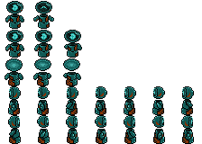 
Fonte: Autoria própria (2026).  

### 3.2.2. Non-Playable Characters (NPC)

Watson é o principal personagem não controlável da narrativa. Cientista-chefe do laboratório e orientador de Sophia em 2022, ele é o responsável por liderar os projetos de Inteligência Artificial que impulsionam a história. Visionário e experiente, Watson antecipa os riscos do uso indevido da tecnologia e toma a decisão crucial de submeter Sophia à criogenia como medida extrema para preservar o conhecimento original do laboratório. Antes do congelamento, ele programa em Asimov o protocolo de despertar, garantindo que, em caso de calamidade, Sophia teria a oportunidade de restaurar o equilíbrio perdido.

Embora não esteja presente fisicamente no futuro, Watson exerce forte influência sobre a narrativa por meio de registros, instruções deixadas nos sistemas e pelas consequências de suas decisões. Ele funciona como catalisador da jornada, sendo a figura que inicia os acontecimentos que estruturam todo o arco do jogo.

Figura 4: Sprite de Watson, NPC. 
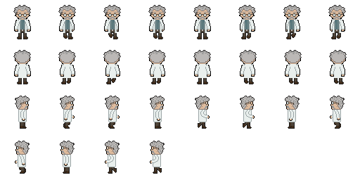 
Fonte: Autoria própria (2026).  

### 3.2.3. Diversidade e Representatividade dos Personagens

A construção dos personagens foi pensada para dialogar diretamente com o público-alvo: estudantes universitários interessados em Inteligência Artificial que buscam uma abordagem mais aplicada e menos teórica. Nesse contexto, a representatividade não se limita a aspectos demográficos, mas também acadêmicos, profissionais e sociais.

Sophia exerce um papel central nesse eixo de diversidade ao representar a presença feminina na ciência e na tecnologia. Em uma área historicamente marcada pela desigualdade de gênero, ela ocupa o lugar de protagonista técnica, estrategista e agente da reconstrução científica. Não é retratada como coadjuvante, mas como responsável pelas decisões críticas, pelo treinamento dos sistemas e pela restauração do laboratório. Sua trajetória simboliza a luta e a consolidação das mulheres em espaços de pesquisa, liderança e inovação, funcionando como referência positiva para jogadoras e jogadores. Além disso, Sophia representa o estudante que aprende pela prática: evolui ao testar hipóteses, ajustar modelos e corrigir falhas, demonstrando que o domínio da IA é construído progressivamente.

Asimov representa a dimensão tecnológica contemporânea. Ele simboliza as ferramentas de apoio ao aprendizado, como plataformas educacionais, ambientes de programação e sistemas inteligentes, que ampliam a capacidade humana sem substituir o raciocínio crítico. Sua evolução ao longo do jogo reforça a ideia de que tecnologia e ser humano devem atuar de forma complementar e ética.

Watson, por sua vez, representa a tradição científica e a responsabilidade institucional. Como cientista-chefe e orientador, ele simboliza a importância da pesquisa estruturada, da formação sólida e da reflexão ética no desenvolvimento tecnológico.

Dessa forma, o jogo promove representatividade de gênero, acadêmica e profissional, posicionando a ciência como espaço acessível, diverso e em constante transformação. A narrativa reforça que o avanço da Inteligência Artificial depende não apenas de inovação técnica, mas também de diversidade, responsabilidade e formação crítica.

## 3.3. Mundo do jogo (sprints 2 e 3)

### 3.3.1. Locações Principais e/ou Mapas (sprints 2 e 3)

O jogo se passa em um laboratório de pesquisa em Inteligência Artificial e robótica. No início da narrativa, em 2022, o ambiente é apresentado como um espaço moderno, organizado e equipado com tecnologias avançadas, transmitindo a sensação de progresso científico e inovação. Após o salto temporal para 2098, quando Sophia desperta da criogenia, o jogador encontra o mesmo laboratório em estado de abandono, com estruturas danificadas, equipamentos quebrados e um ambiente escuro e silencioso, reforçando as consequências do uso indevido da tecnologia ao longo das décadas.

Entre os principais ambientes explorados está a área de sucatas, um setor do laboratório onde foram acumulados equipamentos danificados, peças de robôs e restos de experimentos antigos. Esse espaço funciona como uma área inicial de exploração, onde sophia controla Asimov para navegar entre os destroços e encontrar pistas sobre a localização do cristal necessário para restaurar os sistemas do laboratório.

Após essa etapa, Sophia e Asimov chegam à sala de arquivos, um ambiente onde estão armazenados registros e materiais de antigos experimentos científicos. Nesse local existe um baú contendo folhetos e imagens de diferentes tipos de cristais. Entre esses registros estão tanto imagens do cristal verdadeiro azul, brilhante e pontiagudo; quanto cristais falsos, vermelhos e com imperfeições estruturais.

Em seguida, o jogador acessa a sala da esteira, onde ocorre a fase de classificação. Nesse ambiente, as imagens dos cristais são analisadas e separadas utilizando os comandos de guardar ou incinerar. Após a seleção correta das amostras, os cristais verdadeiros são enviados para um extrator de características, que gera a matriz de dados utilizada para o treinamento do sistema de Asimov.

Por fim, o jogo apresenta a sala principal de controle do laboratório, onde se encontra o núcleo do mapa energético da instalação. Nesse local, Sophia deposita o cristal sintetizado no centro do sistema, restaurando a energia do laboratório e reativando seus principais sistemas, marcando um momento importante na reconstrução da tecnologia e no avanço da narrativa.

Figura 5: Mapa do laboratório inicial. 
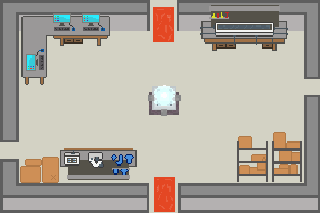 
Fonte: Autoria própria (2026).  

Mais tarde, o jogador retorna ao mesmo laboratório, mas no futuro, encontrando o lugar abandonado, escuro e deteriorado, com máquinas quebradas e um clima mais pesado e silencioso, criando uma sensação de estranheza e suspense ao mostrar como tudo mudou com o tempo. 

Figura 6: Mapa do laboratório no futuro. 
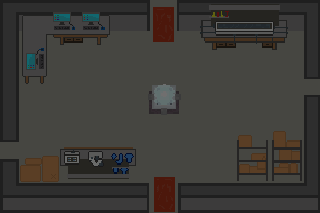 
Fonte: Autoria própria (2026).  

### 3.3.2. Navegação pelo mundo (sprints 2 e 3)

_**Movimentação dos Personagens**_

**Controles de Movimento**

| Tecla | Ação |
| :--- | :--- |
| **↑** | Move o personagem para frente (+Y) |
| **→** | Move o personagem para a direita (+X) |
| **↓** | Move o personagem para trás (−Y) |
| **←** | Move o personagem para a direita (-X) |

---

**Interações**
A tecla **E** é utilizada para interagir com:
* **Itens do cenário**
* **NPCs**

---

**Tipo de Movimentação**
* **Perspectiva:** Terceira pessoa
* **Exploração:** Livre dentro do mapa da fase atual

---

_**Estrutura e Funcionamento**_

| Elemento | Funcionamento |
| :--- | :--- |
| **Estrutura das fases** | Linear |
| **Ordem das fases** | Sequencial e pré-definida |
| **Condição para avançar** | Concluir todas as tasks da fase |
| **Resultado do avanço** | Desbloqueio de nova área |
| **Progressão narrativa** | Acontece a cada fase concluída |

### 3.3.3. Condições climáticas e temporais (sprints 2 e 3)

A existência de diferentes condições climáticas não foi uma possibilidade de aplicação dentro do enredo do jogo pois não foi considerado como fator de importância, devido aos ambientes do jogo se passarem em ambientes internos.

### 3.3.4. Concept Art (sprint 2)

Durante o planejamento do jogo, com o objetivo de obter melhor visualização da proposta dos assets e do encaminhamento do projeto, foram desenvolvidas diversas concept arts relacionadas as cenas e personagens.

Figura 7: Concept Art do Laboratório Inicial do jogo. 
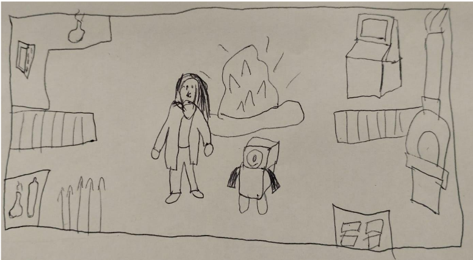 
Fonte: Autoria própria (2026).  

Figura 8: Concept Art do minigame do robô entre sucatas. 
 
Fonte: Autoria própria (2026).  

Figura 9: Concept Art do minigame de Visão Computacional. 
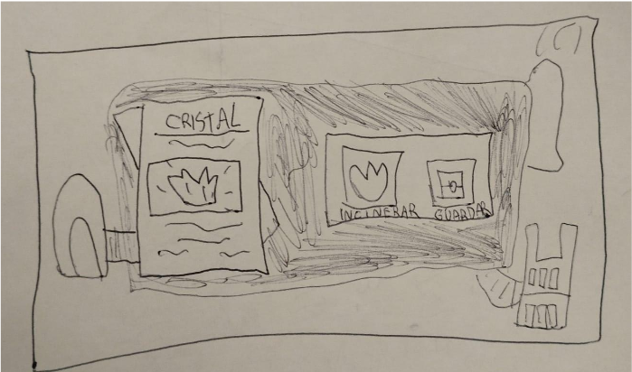 
Fonte: Autoria própria (2026).  

Figura 10: Concept Art do minigame de limpeza de Ruídos. 
 
Fonte: Autoria própria (2026).  

Figura 11: Primeira Concept Art de Asimov. 
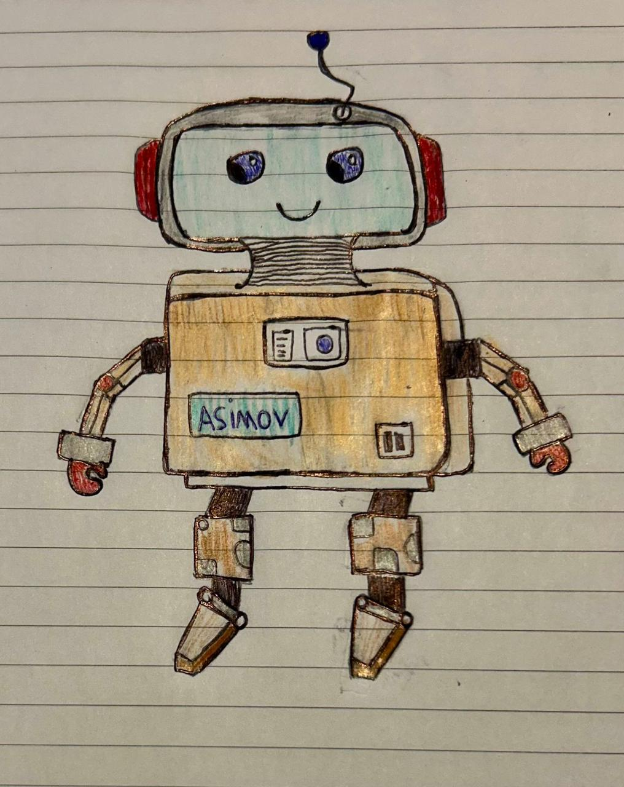 
Fonte: Autoria própria (2026).  

Figura 12: Segunda Concept Art de Asimov. 
 
Fonte: Autoria própria (2026).  

### 3.3.5. Trilha sonora (sprint 4)

*Descreva a trilha sonora do jogo, indicando quais músicas serão utilizadas no mundo e nas fases. Utilize listas ou tabelas para organizar esta seção. Caso utilize material de terceiros em licença Creative Commons, não deixe de citar os autores/fontes.*

*Exemplo de tabela*
\# | titulo | ocorrência | autoria
--- | --- | --- | ---
1 | tema de abertura | tela de início | própria
2 | tema de combate | cena de combate com inimigos comuns | Hans Zimmer
3 | ... 

## 3.4. Inventário e Bestiário (sprint 3)

### 3.4.1. Inventário

\# | item |  | como obter | função 
--- | --- | --- | --- | --- 
1 | baú |  | estão em algumas fases do jogo | guardam recompensas e informações 
2 | envelope |  | estará no primeiro baú | dá informações que serão utiliazadas em uma fase futura
3 | pergaminho |  | estará no primeiro baú | dá informações sobre a história do jogo

### 3.4.2. Bestiário

A existência de inimigos não foi uma possibilidade acordada dentro do enredo do jogo devido ao grau de importância que o grupo concluiu para esse fator, pois o projeto trabalhado será mais focado na resolução de problemas lógicos.

## 3.5. Gameflow (Diagrama de cenas) (sprint 2)

Figura 13: Storyboard de programação 
 
Fonte: Autoria própria (2026). 

## 3.6. Regras do jogo (sprint 3)

*Descreva aqui as regras do seu jogo: objetivos/desafios, meios para se conseguir alcançar*

*Ex. O jogador deve pilotar o carro e conseguir terminar a corrida dentro de um minuto sem bater em nenhum obstáculo.*

*Ex. O jogador deve concluir a fase dentro do tempo, para obter uma estrela. Se além disso ele coletar todas as moedas, ganha mais uma estrela. E se além disso ele coletar os três medalhões espalhados, ganha mais uma estrela, totalizando três. Ao final do jogo, obtendo três estrelas em todas as fases, desbloqueia o mundo secreto.*  

O jogador controla a personagem Sophia, acompanhada do robô Asimov, explorando diferentes áreas de um laboratório futurista para descobrir informações sobre os cristais e restaurar o sistema do local. O objetivo principal é avançar pelas áreas do laboratório resolvendo desafios baseados em conceitos de inteligência artificial.

Inicialmente, o jogador explora o laboratório até chegar à área de sucatas, onde Sophia não consegue avançar devido às condições do ambiente. Nesse momento, o controle passa para Asimov, que deve atravessar a região cheia de obstáculos para permitir a continuidade da exploração.

Após sair da área de sucatas, o jogador precisa treinar Asimov por meio de um minigame de rede neural, no qual o robô aprende a reconhecer padrões. Esse treinamento é necessário para que ele consiga identificar corretamente os padrões das portas do laboratório, permitindo escolher a porta correta e desbloquear o caminho para as próximas áreas.

Em seguida, Sophia e Asimov acessam a sala de arquivamento, localizada após a área de sucatas, onde encontram um baú contendo imagens e registros dos cristais. A partir dessas informações, o jogador participa de um desafio de classificação de cristais em uma esteira, no qual deve analisar as imagens apresentadas e decidir entre guardar os cristais verdadeiros ou incinerar os falsos.

Ao completar corretamente as classificações, o jogador obtém os dados necessários para gerar um cristal funcional, que será utilizado para restaurar o sistema do laboratório. Com isso, o jogo avança para a etapa final, onde Sophia passa a interagir com asimov agora com seu banco de dados completo virando uma super IA generativa que vai ajudar sophia a planejar os próximos passos para restaurar o universo.

## 3.7. Mecânicas do jogo (sprint 3)

As mecânicas do jogo envolvem **exploração do ambiente, interação com objetos e resolução de desafios relacionados à inteligência artificial**. O jogador controla os personagens para investigar o laboratório, coletar informações e completar tarefas necessárias para avançar nas fases.

### Mecânicas principais

**1. Exploração do ambiente**
O jogador pode se movimentar livremente dentro do mapa da fase atual para explorar salas do laboratório, como a área de sucatas, a sala de arquivos, a sala da esteira e a sala de controle principal. Durante a exploração é possível encontrar objetos, registros e equipamentos importantes para a progressão da história.

**2. Interação com objetos e sistemas**
Utilizando a tecla de interação, o jogador pode acessar **baús, arquivos, máquinas e terminais do laboratório**. Esses elementos liberam informações da narrativa ou ativam desafios necessários para continuar a fase.

**3. Investigação e coleta de informações**
Na **sala de arquivos**, o jogador encontra documentos e imagens de diferentes cristais armazenados em um baú. Essas informações ajudam a identificar quais cristais possuem as características corretas.

**4. Classificação de cristais**
Na **sala da esteira**, o jogador deve analisar imagens de cristais e realizar a classificação entre **cristais verdadeiros e falsos**.

* Cristais verdadeiros (azuis, brilhantes e pontiagudos) devem ser **guardados**.
* Cristais falsos (com imperfeições ou coloração diferente) devem ser **incinerados**.

**5. Extração de características**
Após selecionar corretamente os cristais verdadeiros, eles são enviados para um **extrator de características**, que gera uma **matriz de características** com os padrões do cristal correto.

**6. Treinamento da rede neural de Asimov**
Com os dados coletados, o jogador inicia o **treinamento da rede neural de Asimov**. Durante várias tentativas (épocas), o sistema melhora gradualmente sua capacidade de reconhecer padrões, aumentando sua taxa de acerto até alcançar uma precisão elevada.

**7. Restauração do laboratório**
Após o treinamento e a identificação correta do cristal verdadeiro, Sophia pode levá-lo até a **sala principal de controle**, onde o cristal é depositado no centro do sistema energético do laboratório, restaurando parte da energia e permitindo a continuidade da narrativa.

## 3.8. Implementação Matemática de Animação/Movimento (sprint 4)

*Descreva aqui a função que implementa a movimentação/animação de personagens ou elementos gráficos no seu jogo. Sua função deve se basear em alguma formulação matemática (e.g. fórmula de aceleração). A explicação do funcionamento desta função deve conter notação matemática formal de fórmulas/equações. Se necessário, crie subseções para sua descrição.*

# 4. Desenvolvimento do Jogo

## 4.1. Desenvolvimento preliminar do jogo (sprint 1)

Na primeira sprint o grupo desenvolveu a versão inicial do jogo, tendo como foco os requisitos 1 e 2 do Game Design Document (GDD). A primeira versão é composta pela tela inicial, que contém o botão "Play" para que o jogador inicie o jogo.

No decorrer do desenvolvimento, foi construída a tela de uma das fases do jogo, em que o jogador poderá explorar a sala que o personagem está e interagir com um dos items.

Figura 14: Imagem do personagem da primeira fase. 
 
Fonte: Autoria própria (2026).  

Figura 15: Imagem do personagem interagindo com um item. 
 
Fonte: Autoria própria (2026).  

Nesta tela também foram implementados um sistema de colisão básico — em apenas alguns pontos da tela — e um balão de chat.

Figura 16: Imagem da matriz de colisão na primeira tela. 
 
Fonte: Autoria própria (2026).  

Figura 17: Imagem do balão de chat na tela. 
 
Fonte: Autoria própria (2026).  

Para os próximos passos, o grupo deseja implementar os requisitos 3 e 4, adicionar novas fases para implemnetar os requisitos 5 e 6.

## 4.2. Desenvolvimento básico do jogo (sprint 2)

Na segunda sprint o desenvolvimento do jogo foi focado na implementação da tela inicial do jogo, na elaboração dos backgrounds e periféricos das fases e na correção de bugs.

No decorrer do desenvolvimento da segunda sprint, ocorreram alterações estéticas referentes aos cenários das cenas já existentes, que foram estruturados a partir de softwares voltados ao design em pixel art.

Figura 18: Imagem do Laboratório de Cristal ao começo do jogo. 
 
Fonte: Autoria própria (2026).  

Figura 19: Imagem do Laboratório de Cristal ao fim do jogo. 
 
Fonte: Autoria própria (2026).  

Além disso, foram refatorados: os sistemas de colisão para que, ao invés de utilizar um sistema baseado na detecção de diferentes cores, fosse utilizado funções de colisão do Phaser; e a mensagem de texto, para sugerir interação, e as caixas de diálogo, para que ficassem centralizadas e não atrapalhassem a jogabilidade.

Figura 20: Imagem do Laboratório da Cena 01 no jogo. 
 
Fonte: Autoria própria (2026).  

 

Por fim, foram desenvolvidos os designs do background utilizado na Fase 01 e dos objetos utilizados como obstáculos na cena.

Figura 21: Background utilizado na Fase 01. 
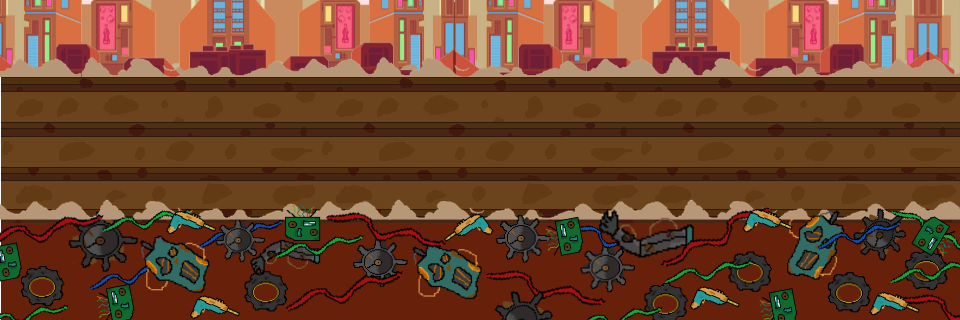 
Fonte: Autoria própria (2026).  

Figura 22: Objetos utilizados na Fase 01. 
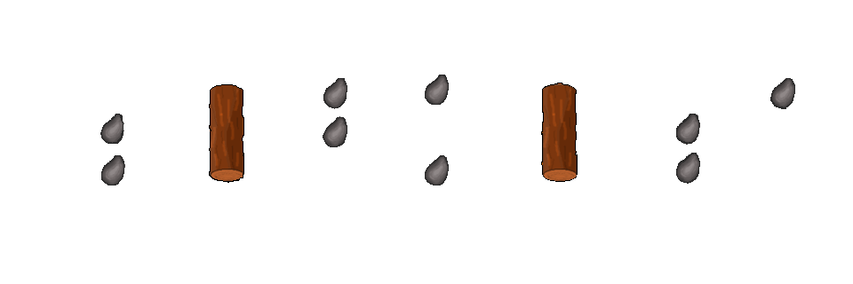 
Fonte: Autoria própria (2026).  

 

## 4.3. Desenvolvimento intermediário do jogo (sprint 3)
Durante a Sprint 3, a equipe concentrou-se na implementação de elementos narrativos e mecânicos fundamentais para o funcionamento do jogo. As atividades foram conduzidas de forma paralela entre os membros da equipe e posteriormente integradas para compor a versão intermediária do jogo entregue nesta etapa.

Uma das frentes de desenvolvimento foi a implementação do sistema de diálogos, responsável por contextualizar a narrativa e orientar o jogador. Foram criados balões de fala para os personagens Dr. Watson e Asimov, permitindo que as interações apresentem a situação do mundo e introduzam conceitos iniciais relacionados aos fundamentos da Inteligência Artificial. Esse sistema também estabelece a progressão narrativa entre o laboratório inicial, o despertar no futuro e o início da primeira fase.

Figura 23: Dialogo com Asimov no futuro. 
 
Fonte: Autoria própria (2026).  

Paralelamente, foi realizada a criação e instanciação dos NPCs no laboratório inicial, adicionando cientistas ao cenário para tornar o ambiente mais dinâmico e reforçar a ambientação de um laboratório ativo no início da narrativa. Esses personagens ajudam a compor o contexto da história antes do evento de criogenia da protagonista.

*imagem do laboratório inicial com os NPCs

A Fase 1 foi implementada e apresenta o robô Asimov em um cenário destruído. O personagem avança automaticamente enquanto o jogador utiliza as setas do teclado para alternar entre três faixas do cenário e a tecla espaço para realizar saltos e evitar obstáculos. A interação com o ambiente utiliza um sistema de colisão baseado na leitura de pixels da imagem de obstáculos, que reinicia a posição do personagem em caso de impacto. Ao final do percurso, o jogador encontra um baú interativo, que ativa uma sequência narrativa responsável por dar continuidade à história.

Figura 24: Fase 1 
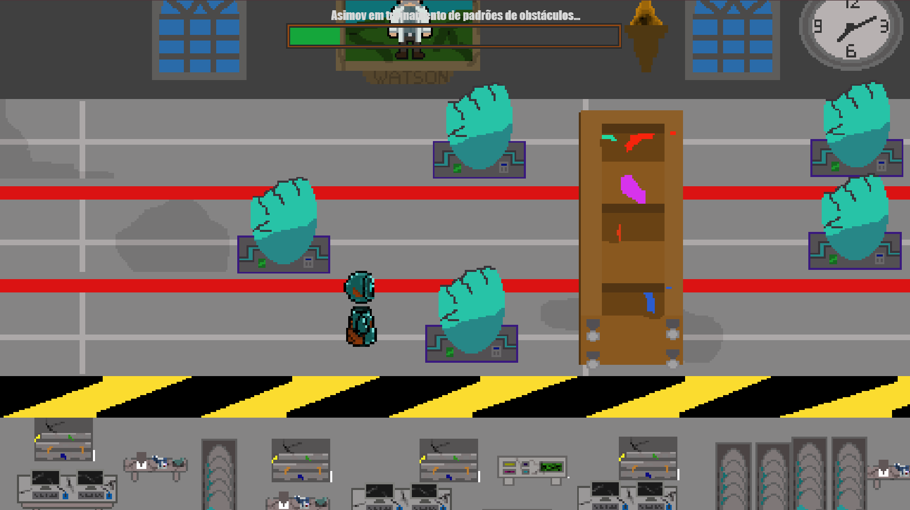 
Fonte: Autoria própria (2026).  

Também foi desenvolvida a cutscene do despertar de Sophia, responsável por conectar narrativamente o passado e o futuro do jogo. A animação apresenta o momento em que Asimov desperta Sophia da criogenia em um laboratório destruído, iniciando a nova etapa da história. A cutscene foi produzida em animação 2D quadro a quadro, utilizando técnicas como onion skinning, onde é possível ver os frames passados e futuros,  para garantir maior fluidez nos movimentos.

Figura 25: CutScene do despertar. 
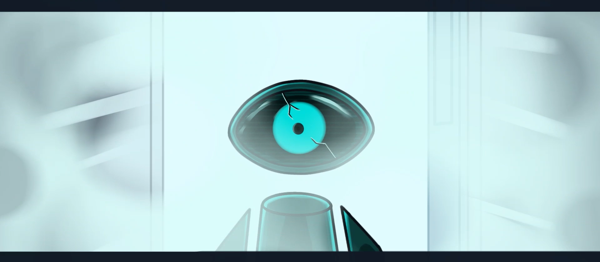 
Fonte: Autoria própria (2026).  

## 4.4. Desenvolvimento final do MVP (sprint 4)

*Descreva e ilustre aqui o desenvolvimento da versão final do jogo, explicando brevemente o que foi entregue em termos de MVP. Utilize prints de tela para ilustrar. Indique as eventuais dificuldades e planos futuros.*

## 4.5. Revisão do MVP (sprint 5)

*Descreva e ilustre aqui o desenvolvimento dos refinamentos e revisões da versão final do jogo, explicando brevemente o que foi entregue em termos de MVP. Utilize prints de tela para ilustrar.*

# 5. Testes

## 5.1. Casos de Teste (sprints 2 a 4)

| pré-condição                          | descrição do teste                              | pós-condição                                              |
|----------------------------------------|--------------------------------------------------|-----------------------------------------------------------|
| partida iniciada                      | pressionar teclas WASD ou setas                 | personagem se move corretamente nas direções corretamente |
| personagem próximo a obstáculo/colisão| movimentar personagem contra a parede/objeto   | personagem não atravessa a parede ou o objeto            |
| missão ativa                          | completar objetivo da missão                   | missão marcada como concluída e recompensa entregue      |
| partida iniciada                      | jogar por 30 min em qualidade alta             | FPS estável                                              |
| usuário acessa URL do jogo            | clica em "iniciar"                              | jogo inicia corretamente                                 |
| jogador atinge condição de derrota    | continuar jogando até perder                   | reiniciar a fase                                         |
| jogo publicado online                 | abrir o jogo em diferentes navegadores         | jogo funciona corretamente em todas                      |

## 5.2. Testes de jogabilidade (playtests) (sprint 5)

### 5.2.1 Registros de testes

*Descreva nesta seção as sessões de teste/entrevista com diferentes jogadores. Registre cada teste conforme o template a seguir.*

Nome | João Jonas (use nomes fictícios)
--- | ---
Já possuía experiência prévia com games? | sim, é um jogador casual
Conseguiu iniciar o jogo? | sim
Entendeu as regras e mecânicas do jogo? | entendeu as regras, mas sobre as mecânicas, apenas as essenciais, não explorou os comandos complexos
Conseguiu progredir no jogo? | sim, sem dificuldades  
Apresentou dificuldades? | Não, conseguiu jogar com facilidade e afirmou ser fácil
Que nota deu ao jogo? | 9.0
O que gostou no jogo? | Gostou  de como o jogo vai ficando mais difícil ao longo do tempo sem deixar de ser divertido
O que poderia melhorar no jogo? | A responsividade do personagem aos controles, disse que havia um pouco de atraso desde o momento do comando até a resposta do personagem

### 5.2.2 Melhorias

*Descreva nesta seção um plano de melhorias sobre o jogo, com base nos resultados dos testes de jogabilidade*

# 6. Conclusões e trabalhos futuros (sprint 5)

*Escreva de que formas a solução do jogo atingiu os objetivos descritos na seção 1 deste documento. Indique pontos fortes e pontos a melhorar de maneira geral.*

*Relacione os pontos de melhorias evidenciados nos testes com plano de ações para serem implementadas no jogo. O grupo não precisa implementá-las, pode deixar registrado aqui o plano para futuros desenvolvimentos.*

*Relacione também quaisquer ideias que o grupo tenha para melhorias futuras*

# 7. Referências (sprint 5)

¹ ABRA. A indústria de games BR e o nicho de jogos educativos. Disponível em: https://abra.com.br/artigos/a-industria-de-games-br-e-o-nicho-de-jogos-educativos. Acesso em: 27 fev. 2026.

² AMAZON WEB SERVICES. AWS DeepRacer. Disponível em: https://aws.amazon.com/pt/deepracer/. Acesso em: 27 fev. 2026.

³ GOOGLE CLOUD. Google Cloud Skills Boost. Disponível em: https://www.cloudskillsboost.google/. Acesso em: 27 fev. 2026.

⁴ CENTRO PAULA SOUZA. CPS lança curso livre online gratuito sobre inteligência artificial. Disponível em: https://www.cps.sp.gov.br/cps-lanca-curso-livre-online-gratuito-sobre-inteligencia-artificial/. Acesso em: 27 fev. 2026.

⁵ ZAKI, Adam. Less than a third of companies follow AI adoption best practices. CFO.com, 2025. Disponível em: https://www.cfo.com/news/less-than-third-of-companies-following-all-of-mckinseys-ai-best-practices-/742279/. Acesso em: 27 fev. 2026.

⁶ NORONHA, Heloísa. Rede pública x rede privada: onde estudam os brasileiros, conforme o IBGE. CNN Brasil, 2025. Disponível em: https://www.cnnbrasil.com.br/educacao/rede-publica-x-rede-privada-onde-estudam-os-brasileiros-conforme-o-ibge/. Acesso em: 27 fev. 2026.

⁷ EXAME. A carreira de IA que ninguém te contou e pode pagar até R$ 1,5 milhão por ano. Exame, 2025. Disponível em: https://exame.com/carreira/a-carreira-de-ia-que-ninguem-te-contou-e-pode-pagar-ate-rs-150-mil-por-ano/. Acesso em: 27 fev. 2026.

⁸ MARKET DATA FORECAST. Gamification education market. Disponível em: https://www.marketdataforecast.com/market-reports/gamification-education-market. Acesso em: 27 fev. 2026.
# Anexos

*Inclua aqui quaisquer complementos para seu projeto, como diagramas, imagens, tabelas etc. Organize em sub-tópicos utilizando headings menores (use ## ou ### para isso)*
