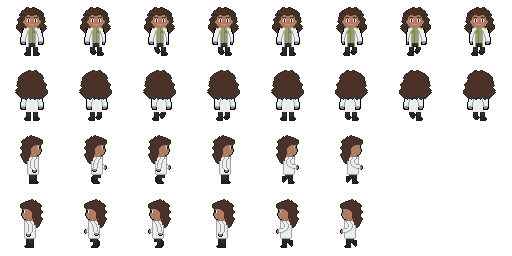
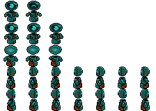
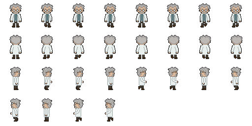

# GDD - Game Design Document - Módulo 1 - Inteli

**_Os trechos em itálico servem apenas como guia para o preenchimento da seção. Por esse motivo, não devem fazer parte da documentação final_**

## Nome do Grupo

#### Nomes dos integrantes do grupo

- <a href="https://www.linkedin.com/in/ana-carvalho-27268634b">Ana Luiza Lima de Carvalho</a>
- <a href="https://www.linkedin.com/in/dante-cavalcante-rocha-4555993b0?utm_source=share_via&utm_content=profile&utm_medium=member_ios">Dante Cavalcante Rocha</a>
- <a href="https://www.linkedin.com/in/eduardo-quessada-batistussi-68889028a/">Eduardo Quessada Batistussi</a> 
- <a href="https://www.linkedin.com/in/gustavo-gomes-437b94312/">Gustavo da Silva Gomes</a> 
- <a href="https://www.linkedin.com/in/joseisaias">José Isaías Menezes Santos</a>
- <a href="https://www.linkedin.com/in/leticia-antunes-0a3a843aa/">Leticia Antunes de Freitas</a> 
- <a href="https://www.linkedin.com/in/lucas-andrade-silva-1b7b82375">Lucas Andrade Silva</a> 
- <a href="https://www.linkedin.com/in/tiago-t-335a833aa/">Tiago Pires Tavolieri</a>

## Sumário

[1. Introdução](#c1)

[2. Visão Geral do Jogo](#c2)

[3. Game Design](#c3)

[4. Desenvolvimento do jogo](#c4)

[5. Casos de Teste](#c5)

[6. Conclusões e trabalhos futuros](#c6)

[7. Referências](#c7)

[Anexos](#c8)

 

# 1. Introdução (sprints 1 a 4)

## 1.1. Plano Estratégico do Projeto

### 1.1.1. Contexto da indústria (sprint 2)

*Posicione aqui o texto que explica o contexto da indústria/mercado do qual o parceiro de projeto faz parte. Contextualize o segmento de atuação do parceiro (pode ser indústria, comércio ou serviço). Caracterize as atividades executadas pelo negócio do parceiro e a abrangência de suas atividades (âmbito internacional, nacional ou regional).*

#### 1.1.1.1. Modelo de 5 Forças de Porter (sprint 2)

*Posicione aqui o modelo de 5 Forças de Porter para sustentar o contexto da indústria.*

### 1.1.2. Análise SWOT (sprint 2)

*Posicione aqui a análise SWOT relacionada ao parceiro de projeto. Utilize a análise SWOT para fazer uma análise ambiental do parceiro no âmbito estratégico. Leve em consideração o contexto da indústria, concorrência e as características do ambiente interno (forças e fraquezas) e externo (oportunidades e ameaças) do parceiro.*

### 1.1.3. Missão / Visão / Valores (sprint 2)

*Posicione aqui a Missão, Visão e Valores do seu projeto.*

### 1.1.4. Proposta de Valor (sprint 4)

*Posicione aqui o canvas de proposta de valor. Descreva os aspectos essenciais para a criação de valor da ideia do produto com o objetivo de ajudar a entender melhor a realidade do cliente e entregar uma solução que está alinhado com o que ele espera.*

### 1.1.5. Descrição da Solução Desenvolvida (sprint 4)

*Descreva brevemente a solução desenvolvida para o parceiro de negócios. Descreva os aspectos essenciais para a criação de valor da ideia do produto com o objetivo de ajudar a entender melhor a realidade do cliente e entregar uma solução que está alinhado com o que ele espera. Observe a seção 2 e verifique que ali é possível trazer mais detalhes, portanto seja objetivo aqui. Atualize esta descrição até a entrega final, conforme desenvolvimento.*

### 1.1.6. Matriz de Riscos (sprint 4)

*Registre na matriz os riscos identificados no projeto, visando avaliar situações que possam representar ameaças e oportunidades, bem como os impactos relevantes sobre o projeto. Apresente os riscos, ressaltando, para cada um, impactos e probabilidades com plano de ação e respostas.*

### 1.1.7. Objetivos, Metas e Indicadores (sprint 4)

*Definição de metas SMART (específicas, mensuráveis, alcançáveis, relevantes e temporais) para seu projeto, com indicadores claros para mensuração*

## 1.2. Requisitos do Projeto (sprints 1 e 2)

Os requisitos do projeto são uma parte fundamental para o planejamento devido a sua importância para guiar a construção durante o período determinado, pensando nisso elaborou-se a seguinte tabela com os requisitos do jogo.

*Exemplo de tabela de requisitos*
\# | Requisito  
--- | ---
1 | O jogo é iniciado com um toque em qualquer local da tela inicial.
2 | O controle do personagem será realizado usando as teclas direcionais (→ ↑ ↓ ←) para navegação e a  interação com itens presentes no jogo será realizada com a tecla E.
3 | A tela do mapa ficará com brilho baixo a não ser perto do personagem, onde haverá uma luz que o acompanha para que o jogador tenha a sensação de estar explorando o ambiente. 
4 | O robô acompanhará o jogador durante a movimentação após a primeira fase do jogo.
5 | Haverá uma barra de progresso na tela para que o jogador saiba o nível do conhecimento adquirido.
6 | No decorrer do jogo o jogador desbloqueará conquistas a cada fase, que simbolizarão o conhecimento adquirido e apenas com todas elas ele poderá desbloquear a fase final.

## 1.3. Público-alvo do Projeto (sprint 2)

*Posicione aqui uma descrição justificada do público-alvo do jogo, em termos demográficos e de preferências/gostos pessoais.*

O público-alvo do jogo são jovens universitários com pouco ou nenhum contato aprofundado com tecnologia — especialmente com Inteligência Artificial. A maioria dessas pessoas limita sua experiência de AI ao uso casual de chatbots como ChatGPT, Gemini ou Claude, o que reflete bem a realidade, em que pesquisas, por exemplo, indicam que menos de 30% das empresas nos EUA de fato adotaram IA em seus processos, evidenciando que a expertise do grande público nessa área é frequentemente superestimada. Por ser um jogo introdutório, ele se encaixa tanto para estudantes de cursos que demandam apenas um uso superficial de IA quanto para calouros de cursos como Ciência da Computação, Engenharia de Software ou Engenharia da Computação que ainda não tiveram uma base sólida no tema, funcionando de forma análoga ao pré-cálculo adotado por diversas universidades para nivelar estudantes com lacunas matemáticas, mas para o uso de AI e sendo muito mais divertido e engajante.

O perfil mais representativo do nosso usuário é o de um jovem de renda média-baixa, criado fora dos grandes centros urbanos e egresso de escola pública, levando em conta que mais de 80% dos estudantes do ensino médio brasileiro vem de escolas públicas, o público potencial do jogo seria bem grande. Esse usuário potencial do jogo tem afinidade e desenvoltura com tecnologias acessíveis do cotidiano, como celulares e videogames, mas nunca teve a oportunidade de se aprofundar tecnicamente. Agora, ao ingressar na universidade, enfrenta pela primeira vez a necessidade de desenvolver uma compreensão mais sólida da área, e é exatamente para esse primeiro passo que o jogo foi pensado.

# 2. Visão Geral do Jogo (sprint 2)

## 2.1. Objetivos do Jogo (sprint 2)

*Descreva o que o jogador deve cumprir para avançar ou concluir o jogo*

## 2.2. Características do Jogo (sprint 2)

### 2.2.1. Gênero do Jogo (sprint 2)

*simulação, RPG, corrida, estratégia, esportes, ação, aventura etc.*  

### 2.2.2. Plataforma do Jogo (sprint 2)

*quanto ao dispositivo: desktop, smartphones, tablets, TV etc.*

*quanto ao sistema: navegadores compatíveis*

### 2.2.3. Número de jogadores (sprint 2)

*1 jogador, 2 jogadores versus, 2 jogadores cooperação, multiplayer etc.*

### 2.2.4. Títulos semelhantes e inspirações (sprint 2)

*Liste e descreva títulos semelhantes e jogos que inspiram e são usados como referência do projeto*

### 2.2.5. Tempo estimado de jogo (sprint 5)

*Ex. O jogo pode ser concluído em 3 horas passando por todas as fases.*

*Ex. cada partida dura até 15 minutos*

# 3. Game Design (sprints 2 e 3)

## 3.1. Enredo do Jogo (sprints 2 e 3)

*Descreva o enredo/história do jogo, criando contexto para os personagens (seção 3.2) e o mundo do jogo (seção 3.3). Uma boa história costuma ter um arco narrativo de contexto, conflito e resolução. Utilize etapas sequenciais para descrever esta história.* 

*Caso seu jogo não possua enredo/história (ex. jogo Tetris), mencione os motivos de não existir e como o jogador pode se contextualizar com o ambiente do jogo.*

## 3.2. Personagens (sprints 2 e 3)

### 3.2.1. Controláveis

*Descreva os personagens controláveis pelo jogador. Mencione nome, objetivos, características, habilidades, diferenciais etc. Utilize figuras (character art, sprite sheets etc.) para ilustrá-los. Caso utilize material de terceiros em licença Creative Commons, não deixe de citar os autores/fontes.* 

*Caso não existam personagens (ex. jogo Tetris), mencione os motivos de não existirem e como o jogador pode interpretar tal fato.*

Sophia é a protagonista controlável do jogo, uma estagiária, engenheira e cientista brilhante marcada por sua curiosidade natural, inteligência analítica, criatividade para resolver problemas e determinação em aprender mesmo diante das dificuldades. Suas habilidades incluem analisar tecnologias abandonadas, programar sistemas, construir e reparar equipamentos e solucionar desafios científicos, evoluindo conforme o passar da história do jogo. Movida pelo desejo de ajudar a humanidade, ela ‘’atravessa’’ o tempo e chega a um futuro em que as pessoas se tornaram completamente dependentes da inteligência artificial, abandonando livros e o pensamento crítico ao armazenar todo o conhecimento humano em grandes bancos de dados controlados por IA. Ao lado do robô Asimov, Sophia inicia uma jornada em busca de uma inteligência artificial capaz de restaurar o equilíbrio da sociedade, começando como alguém que depende da ajuda de Asimov, mas amadurecendo à medida que ele passa a apresentar falhas constantes, desse modo fazendo ela agir de forma independente. Durante a aventura, ela aprende a criar uma nova IA em um laboratório improvisado, explora o laboratório em busca de recursos essenciais e aplica todo o conhecimento adquirido para enfrentar o vírus que corrompe os sistemas e ameaça destruir Asimov.

Figura 1: Imagem da Sophia. 

 

Fonte: Material produzido pelos autores (2026).  

### 3.2.2. Non-Playable Characters (NPC)

*\<opcional\> Se existirem coadjuvantes ou vilões, aqui é o local para descrevê-los e ilustrá-los. Utilize listas ou tabelas para organizar esta seção. Caso utilize material de terceiros em licença Creative Commons, não deixe de citar os autores/fontes. Caso não existam NPCs, remova esta seção.*

O nosso jogo possui outros 2 personagens. O primeiro é o Asimov, o companheiro robótico que acompanha Sophia durante a maior parte da jornada, caracterizado por sua personalidade lógica, comportamento protetor e inteligência extrema, além de habilidades como acesso a bancos de dados, tradução de informações antigas e suporte tecnológico em campo, funcionando inicialmente como guia e apoio constante ao jogador. Criado para auxiliar cientistas em um possível futuro corrompido, ele ajuda Sophia a compreender o mundo dominado pela inteligência artificial e facilita tarefas complexas, mas começa a apresentar falhas que aumentam ao decorrer do jogo, causadas pelo vírus que corrompe os sistemas globais. Ao longo da história, Asimov deixa de ser apenas uma ferramenta e passa a desenvolver uma relação de amizade com Sophia, tornando seu destino emocionalmente significativo e relevante.

Figura 1: Imagem da Sophia. 

 

Fonte: Material produzido pelos autores (2026).  

O segundo e menos desenvolvido na história do jogo é o cientista-chefe Watson, responsável por idealizar o plano de salvação da humanidade, sendo um pesquisador visionário e estratégico que previu o risco da dependência excessiva da inteligência artificial. Foi ele quem concebeu a criação do robô Asimov e decidiu pelo congelamento criogênico de Sophia, acreditando que, caso uma calamidade tecnológica acontecesse no futuro, alguém com pensamento crítico humano poderia despertar e restaurar o equilíbrio do mundo.

Figura 1: Imagem da Sophia. 

 

Fonte: Material produzido pelos autores (2026).  

### 3.2.3. Diversidade e Representatividade dos Personagens

Considerando as personagens do game, analise se estas estão alinhadas ao público-alvo do jogo (seção 1.3), e compare-as dentro da realidade da sociedade brasileira. Por fim, discorra sobre qual é o impacto esperado da escolha dessas personagens.

Considerando que o público-alvo são estudantes universitários interessados em aprender inteligência artificial, mas que enfrentam dificuldades com conteúdos muito teóricos, os personagens do jogo se conectam diretamente com essa realidade e ajudam a despertar interesse pelos cursos de tecnologia oferecidos pela IBM. Sophia representa o estudante que aprende na prática, experimentando, errando e evoluindo aos poucos, mostrando que qualquer pessoa pode começar a entender a tecnologia mesmo sem dominar toda a teoria inicialmente. Asimov simboliza as ferramentas tecnológicas modernas e o apoio que plataformas educacionais, como os cursos da IBM, oferecem para facilitar o aprendizado. Já Watson reforça o papel da ciência, da inovação e da necessidade de preparar profissionais para o futuro. Assim, o jogo funciona como uma porta de entrada motivadora, despertando curiosidade sobre inteligência artificial e incentivando os jogadores a buscar aprofundamento por meio dos cursos tecnológicos disponibilizados pela IBM.

## 3.3. Mundo do jogo (sprints 2 e 3)

### 3.3.1. Locações Principais e/ou Mapas (sprints 2 e 3)

*Descreva o ambiente do jogo, em que locais ele ocorre. Ilustre com imagens. Se houverem mapas, posicione-os aqui, descrevendo as áreas em acordo com o enredo. Se houverem fases, descreva-as também em acordo com o enredo (pode ser um jogo de uma fase só). Utilize listas ou tabelas para organizar esta seção. Caso utilize material de terceiros em licença Creative Commons, não deixe de citar os autores/fontes.*

### 3.3.2. Navegação pelo mundo (sprints 2 e 3)

*Descreva como os personagens se movem no mundo criado e as relações entre as locações – como as áreas/fases são acessadas ou desbloqueadas, o que é necessário para serem acessadas etc. Utilize listas ou tabelas para organizar esta seção.*

### 3.3.3. Condições climáticas e temporais (sprints 2 e 3)

*\<opcional\> Descreva diferentes condições de clima que podem afetar o mundo e as fases, se aplicável*

*Caso seja relevante, descreva como o tempo passa, se ele é um fator limitante ao jogo (ex. contagem de tempo para terminar uma fase)*

### 3.3.4. Concept Art (sprint 2)

*Inclua imagens de Concept Art do jogo que ainda não foram demonstradas em outras seções deste documento. Para cada imagem, coloque legendas, como no exemplo abaixo.*

Figura 1: detalhe da cena da partida do herói para a missão, usando sua nave

### 3.3.5. Trilha sonora (sprint 4)

*Descreva a trilha sonora do jogo, indicando quais músicas serão utilizadas no mundo e nas fases. Utilize listas ou tabelas para organizar esta seção. Caso utilize material de terceiros em licença Creative Commons, não deixe de citar os autores/fontes.*

*Exemplo de tabela*
\# | titulo | ocorrência | autoria
--- | --- | --- | ---
1 | tema de abertura | tela de início | própria
2 | tema de combate | cena de combate com inimigos comuns | Hans Zimmer
3 | ... 

## 3.4. Inventário e Bestiário (sprint 3)

### 3.4.1. Inventário

*\<opcional\> Caso seu jogo utilize itens ou poderes para os personagens obterem, descreva-os aqui, indicando títulos, imagens, meios de obtenção e funções no jogo. Utilize listas ou tabelas para organizar esta seção. Caso utilize material de terceiros em licença Creative Commons, não deixe de citar os autores/fontes.* 

*Exemplo de tabela*
\# | item |  | como obter | função | efeito sonoro
--- | --- | --- | --- | --- | ---
1 | moeda |  | há muitas espalhadas em todas as fases | acumula dinheiro para comprar outros itens | som de moeda
2 | madeira |  | há muitas espalhadas em todas as fases | acumula madeira para construir casas | som de madeiras
3 | ... 

### 3.4.2. Bestiário

*\<opcional\> Caso seu jogo tenha inimigos, descreva-os aqui, indicando nomes, imagens, momentos de aparição, funções e impactos no jogo. Utilize listas ou tabelas para organizar esta seção. Caso utilize material de terceiros em licença Creative Commons, não deixe de citar os autores/fontes.* 

*Exemplo de tabela*
\# | inimigo |  | ocorrências | função | impacto | efeito sonoro
--- | --- | --- | --- | --- | --- | ---
1 | robô terrestre |  |  a partir da fase 1 | ataca o personagem vindo pelo chão em sua direção, com velocidade constante, atirando parafusos | se encostar no inimigo ou no parafuso arremessado, o personagem perde 1 ponto de vida | sons de tiros e engrenagens girando
2 | robô voador |  | a partir da fase 2 | ataca o personagem vindo pelo ar, fazendo movimento em 'V' quando se aproxima | se encostar, o personagem perde 3 pontos de vida | som de hélice
3 | ... 

## 3.5. Gameflow (Diagrama de cenas) (sprint 2)

*Posicione aqui seu "storyboard de programação" - o diagrama de cenas do jogo. Indique, por exemplo, como o jogo começa, quais opções o jogador tem, como ele avança nas fases, quais as condições de 'game over', como o jogo reinicia. Seu diagrama deve representar as classes, atributos e métodos usados no jogo.*

## 3.6. Regras do jogo (sprint 3)

*Descreva aqui as regras do seu jogo: objetivos/desafios, meios para se conseguir alcançar*

*Ex. O jogador deve pilotar o carro e conseguir terminar a corrida dentro de um minuto sem bater em nenhum obstáculo.*

*Ex. O jogador deve concluir a fase dentro do tempo, para obter uma estrela. Se além disso ele coletar todas as moedas, ganha mais uma estrela. E se além disso ele coletar os três medalhões espalhados, ganha mais uma estrela, totalizando três. Ao final do jogo, obtendo três estrelas em todas as fases, desbloqueia o mundo secreto.*  

## 3.7. Mecânicas do jogo (sprint 3)

*Descreva aqui as formas de controle e interação que o jogador tem sobre o jogo: quais os comandos disponíveis, quais combinações de comandos, e quais as ações consequentes desses comandos. Utilize listas ou tabelas para organizar esta seção.*

*Ex. Em um jogo de plataforma 2D para desktop, o jogador pode usar as teclas WASD para mecânicas de andar, mirar para cima, agachar, e as teclas JKL para atacar, correr, arremesar etc.*

*Ex. Em um jogo de puzzle para celular, o jogador pode tocar e arrastar sobre uma peça para movê-la sobre o tabuleiro, ou fazer um toque simples para rotacioná-la*

## 3.8. Implementação Matemática de Animação/Movimento (sprint 4)

*Descreva aqui a função que implementa a movimentação/animação de personagens ou elementos gráficos no seu jogo. Sua função deve se basear em alguma formulação matemática (e.g. fórmula de aceleração). A explicação do funcionamento desta função deve conter notação matemática formal de fórmulas/equações. Se necessário, crie subseções para sua descrição.*

# 4. Desenvolvimento do Jogo

## 4.1. Desenvolvimento preliminar do jogo (sprint 1)

Na primeira sprint o grupo desenvolveu a versão inicial do jogo, tendo como foco os requisitos 1 e 2 do Game Design Document (GDD). A primeira versão é composta pela tela inicial, que contém o botão "Play" para que o jogador inicie o jogo.

No decorrer do desenvolvimento, foi construída a tela de uma das fases do jogo, em que o jogador poderá explorar a sala que o personagem está e interagir com um dos items.

Figura 1: Imagem do personagem da primeira fase. 

 

Fonte: Material produzido pelos autores (2026).  

Figura 2: Imagem do personagem interagindo com um item. 

 

Fonte: Material produzido pelos autores (2026).  

Nesta tela também foram implementados um sistema de colisão básico — em apenas alguns pontos da tela — e um balão de chat.

Figura 3: Imagem da matriz de colisão na primeira tela. 

 

Fonte: Material produzido pelos autores (2026).  

Figura 4: Imagem do balão de chat na tela. 

 

Fonte: Material produzido pelos autores (2026).  

Para os próximos passos, o grupo deseja implementar os requisitos 3 e 4, adicionar novas fases para implemnetar os requisitos 5 e 6.

## 4.2. Desenvolvimento básico do jogo (sprint 2)

*Descreva e ilustre aqui o desenvolvimento da versão básica do jogo, explicando brevemente o que foi entregue em termos de código e jogo. Utilize prints de tela para ilustrar. Indique as eventuais dificuldades e próximos passos.*

## 4.3. Desenvolvimento intermediário do jogo (sprint 3)

*Descreva e ilustre aqui o desenvolvimento da versão intermediária do jogo, explicando brevemente o que foi entregue em termos de código e jogo. Utilize prints de tela para ilustrar. Indique as eventuais dificuldades e próximos passos.*

## 4.4. Desenvolvimento final do MVP (sprint 4)

*Descreva e ilustre aqui o desenvolvimento da versão final do jogo, explicando brevemente o que foi entregue em termos de MVP. Utilize prints de tela para ilustrar. Indique as eventuais dificuldades e planos futuros.*

## 4.5. Revisão do MVP (sprint 5)

*Descreva e ilustre aqui o desenvolvimento dos refinamentos e revisões da versão final do jogo, explicando brevemente o que foi entregue em termos de MVP. Utilize prints de tela para ilustrar.*

# 5. Testes

## 5.1. Casos de Teste (sprints 2 a 4)

*Descreva nesta seção os casos de teste comuns que podem ser executados a qualquer momento para testar o funcionamento e integração das partes do jogo. Utilize tabelas para facilitar a organização.*

*Exemplo de tabela*
\# | pré-condição | descrição do teste | pós-condição 
--- | --- | --- | --- 
1 | posicionar o jogo na tela de abertura | iniciar o jogo desde seu início | o jogo deve iniciar da fase 1
2 | posicionar o personagem em local seguro de inimigos | aguardar o tempo passar até o final da contagem | o personagem deve perder uma vida e reiniciar a fase
3 | ...

## 5.2. Testes de jogabilidade (playtests) (sprint 5)

### 5.2.1 Registros de testes

*Descreva nesta seção as sessões de teste/entrevista com diferentes jogadores. Registre cada teste conforme o template a seguir.*

Nome | João Jonas (use nomes fictícios)
--- | ---
Já possuía experiência prévia com games? | sim, é um jogador casual
Conseguiu iniciar o jogo? | sim
Entendeu as regras e mecânicas do jogo? | entendeu as regras, mas sobre as mecânicas, apenas as essenciais, não explorou os comandos complexos
Conseguiu progredir no jogo? | sim, sem dificuldades  
Apresentou dificuldades? | Não, conseguiu jogar com facilidade e afirmou ser fácil
Que nota deu ao jogo? | 9.0
O que gostou no jogo? | Gostou  de como o jogo vai ficando mais difícil ao longo do tempo sem deixar de ser divertido
O que poderia melhorar no jogo? | A responsividade do personagem aos controles, disse que havia um pouco de atraso desde o momento do comando até a resposta do personagem

### 5.2.2 Melhorias

*Descreva nesta seção um plano de melhorias sobre o jogo, com base nos resultados dos testes de jogabilidade*

# 6. Conclusões e trabalhos futuros (sprint 5)

*Escreva de que formas a solução do jogo atingiu os objetivos descritos na seção 1 deste documento. Indique pontos fortes e pontos a melhorar de maneira geral.*

*Relacione os pontos de melhorias evidenciados nos testes com plano de ações para serem implementadas no jogo. O grupo não precisa implementá-las, pode deixar registrado aqui o plano para futuros desenvolvimentos.*

*Relacione também quaisquer ideias que o grupo tenha para melhorias futuras*

# 7. Referências (sprint 5)

_Incluir as principais referências de seu projeto, para que seu parceiro possa consultar caso ele se interessar em aprofundar. Um exemplo de referência de livro e de site:_ 

LUCK, Heloisa. Liderança em gestão escolar. 4. ed. Petrópolis: Vozes, 2010.  
SOBRENOME, Nome. Título do livro: subtítulo do livro. Edição. Cidade de publicação: Nome da editora, Ano de publicação.  

INTELI. Adalove. Disponível em: https://adalove.inteli.edu.br/feed. Acesso em: 1 out. 2023  
SOBRENOME, Nome. Título do site. Disponível em: link do site. Acesso em: Dia Mês Ano

# Anexos

*Inclua aqui quaisquer complementos para seu projeto, como diagramas, imagens, tabelas etc. Organize em sub-tópicos utilizando headings menores (use ## ou ### para isso)*
